[← Sieci komputerowe](README.md) · [RIP](RIP.md) · [OSPF](OSPF.md) · [MikroTik](MikroTik_RIP_OSPF_RouterOS_v7.md)

# RIP I OSPF

**PDF:** [Pobierz dokument](https://github.com/tomaszmakaedu/materialy-dydaktyczne/raw/refs/heads/main/ZSEM/Klasa%204/Sieci%20komputerowe/Kompendium_RIP_OSPF_MikroTik_RouterOS_v7_loopback.pdf) · **Autor:** Tomasz Mąka · **ZSEM, klasa 4t**

> Ilustracje zamieszczono poniżej; pełny układ materiału jest dostępny także w PDF.

## Routing dynamiczny w MikroTik RouterOS v7

Kompendium teoretyczne i praktyczne dla uczniów klasy 4 technikum, kierunek technik teleinformatyk.

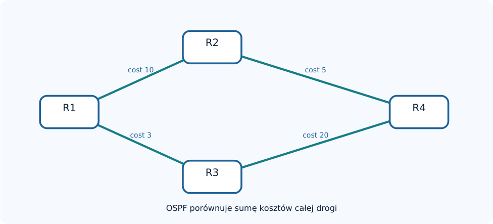

Zakres: tablica routingu, RIP i RIPv2, OSPFv2, obszary, sąsiedztwo, metryki, konfiguracja terminalowa,
schematy WinBox, diagnostyka, ćwiczenia i pytania kontrolne.

## 1. Podstawy routingu w sieciach IP

Router łączy sieci warstwy trzeciej modelu OSI. Dla pakietu IP sprawdza docelowy adres, wyszukuje
pasujący prefiks w tablicy przekazywania i kieruje pakiet do następnego routera albo do sieci
bezpośrednio podłączonej. Decyzję podejmuje na podstawie routingu, a nie adresu MAC komputera w
odległej sieci.

### 1.1. Trasa, next-hop, prefiks i brama

Prefiks docelowy określa sieć (np. 192.168.30.0/24). Next-hop to adres następnego routera, który może
przekazać pakiet dalej. Trasa connected pojawia się po skonfigurowaniu adresu IP na działającym
interfejsie. Trasa statyczna jest wpisywana przez administratora, a dynamiczna może zostać nauczona
przez protokół routingu.

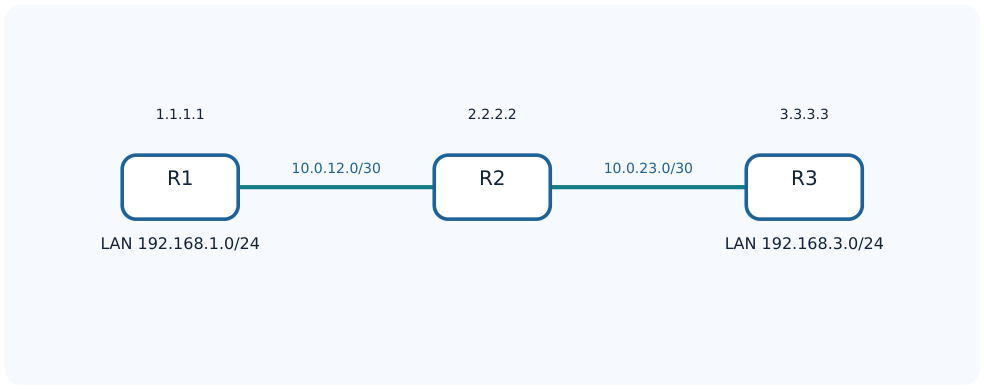

*Rysunek 1. Trzy routery, dwa łącza tranzytowe i dwie odległe sieci LAN.*

| Pojęcie | Znaczenie | Przykład |
| --- | --- | --- |
| Sieć docelowa | prefiks poszukiwany w routingu | 192.168.3.0/24 |
| Next-hop | następny router na drodze | 10.0.12.2 |
| Connected | sieć lokalnie podłączona | 10.0.12.0/30 |
| Default route | trasa dla nieznanych celów | 0.0.0.0/0 |

### 1.2. RIB, FIB i wybór trasy

RIB (Routing Information Base) zbiera informacje o trasach pochodzących z różnych źródeł. FIB
(Forwarding Information Base) zawiera informacje wykorzystywane do faktycznego przekazywania
pakietów. Przy wyborze trasy znaczenie mają m.in. długość prefiksu, jej aktywność, dostępność
następnego skoku oraz administracyjna odległość. Metryki różnych protokołów nie są bezpośrednio
porównywalne.

```routeros
/ip route print
/routing route print detail
```

### 1.3. Routing statyczny i dynamiczny

Trasa statyczna wymaga ręcznej konfiguracji, np. 192.168.3.0/24 przez 10.0.12.2. W routingu
dynamicznym routery wymieniają wiedzę o osiągalności prefiksów. Gdy łącze ulegnie awarii, protokół
może wykryć zmianę i wyznaczyć trasę zastępczą, o ile istnieje alternatywna droga.

```routeros
/ip route add dst-address=192.168.3.0/24 gateway=10.0.12.2
```

### 1.4. IGP i EGP

IGP (Interior Gateway Protocol) służy do routingu wewnątrz jednej domeny administracyjnej. RIP i OSPF
należą do IGP. BGP to protokół wykorzystywany głównie między systemami autonomicznymi. RIP jest
protokołem wektora odległości, a OSPF protokołem stanu łącza.

##

2. RIP — Routing Information Protocol

RIP to protokół IGP typu distance-vector. Routery wymieniają informacje o znanych prefiksach i ich
odległości. Metryką jest liczba skoków (hop count). Protokół preferuje drogę o mniejszej liczbie skoków,
niezależnie od rzeczywistej przepustowości. RIPv2 obsługuje maski CIDR/VLSM, używa UDP/520 i zwykle
rozsyła okresowe aktualizacje w odstępach około 30 sekund.

| Cecha | RIPv2 |
| --- | --- |
| Typ | distance-vector / IGP |
| Metryka | liczba skoków |
| Osiągalna metryka | 1–15; 16 oznacza nieosiągalność |
| Transport | UDP, port 520 |
| Multicast IPv4 | 224.0.0.9 |
| Standaryzacja | RFC 2453 |

### 2.1. Jak router „uczy się” trasy

Jeżeli R3 ogłasza swoją sieć LAN 192.168.3.0/24 do R2, R2 może przekazać tę wiedzę do R1 z
odpowiednio powiększoną metryką. R1 zapisuje next-hop w stronę R2. Router nie tworzy pełnej mapy
połączeń — zna kierunek i liczbę skoków do osiągalnych prefiksów.


*Rysunek
2. Rozgłaszanie prefiksu 192.168.3.0/24 kolejno z R3 do R2 i R1.*

### 2.2. Limit 15 skoków

RIP uznaje metrykę 16 za nieskończoność. Ogranicza to zjawisko count-to-infinity, ale jednocześnie
powoduje, że protokół nie skaluje się do długich łańcuchów routerów. Uwaga: hop count nie opisuje
opóźnienia, przeciążenia ani przepustowości łączy.

### 2.3. Pętle routingu i zabezpieczenia

Count-to-infinity może wystąpić, gdy routery błędnie informują się wzajemnie o trasie, która przestała
istnieć. Split horizon zapobiega ogłaszaniu trasy z powrotem przez interfejs, przez który została
poznana. Poison reverse może ogłaszać taką trasę z metryką 16. Route poisoning oznacza oznaczenie
trasy niedostępnej metryką nieskończoną. Timery oraz aktualizacje wyzwalane pomagają reagować na
zmiany, ale nie eliminują wszystkich ograniczeń RIP.

### 2.4. RIP w RouterOS v7

RouterOS v7 udostępnia konfigurację przez /routing rip instance i /routing rip interface-template.
Interfejsy i sąsiedzi służą do obserwacji działania. Dla IPv4 stosujemy RIPv2, nie RIPv1. W przykładach
poniżej każdy router ma już aktywne interfejsy i poprawną konfigurację IP.


*Rysunek
3. Poglądowy odpowiednik okna WinBox: RIP → Instances.*

```routeros
/routing rip instance
add name=RIP1 afi=ipv4 redistribute=connected
```

Parametr redistribute=connected wprowadza do RIP sieci connected. W środowisku produkcyjnym
redystrybucję trzeba ograniczać i kontrolować; poniższy przykład jest przygotowany do osobnego
laboratorium.


*Rysunek
4. Poglądowy odpowiednik okna WinBox: RIP → Interface Templates.*

```routeros
/routing rip interface-template
add instance=RIP1 interfaces=ether2 split-horizon=yes
```

### 2.5. Laboratorium RIP: trzy routery


*Rysunek
5. Topologia laboratorium RIP. Interfejsy są wskazane w tabeli poniżej.*

| Router | Interfejs | Adres IPv4 | Rola |
| --- | --- | --- | --- |
| R1 | ether1 | 192.168.1.1/24 | LAN |
| R1 | ether2 | 10.0.12.1/30 | do R2 |
| R2 | ether1 | 10.0.12.2/30 | do R1 |
| R2 | ether2 | 10.0.23.1/30 | do R3 |
| R3 | ether1 | 10.0.23.2/30 | do R2 |
| R3 | ether2 | 192.168.3.1/24 | LAN |

### R1

```routeros
/ip address
add address=192.168.1.1/24 interface=ether1
add address=10.0.12.1/30 interface=ether2
/routing rip instance
add name=RIP1 afi=ipv4 redistribute=connected
/routing rip interface-template
add instance=RIP1 interfaces=ether2 split-horizon=yes
```

### R2

```routeros
/ip address
add address=10.0.12.2/30 interface=ether1
add address=10.0.23.1/30 interface=ether2
/routing rip instance
add name=RIP1 afi=ipv4 redistribute=connected
/routing rip interface-template
add instance=RIP1 interfaces=ether1 split-horizon=yes
add instance=RIP1 interfaces=ether2 split-horizon=yes
```

### R3

```routeros
/ip address
add address=10.0.23.2/30 interface=ether1
add address=192.168.3.1/24 interface=ether2
/routing rip instance
add name=RIP1 afi=ipv4 redistribute=connected
/routing rip interface-template
add instance=RIP1 interfaces=ether1 split-horizon=yes
```

### Weryfikacja i interpretacja

```routeros
/routing rip instance print detail
/routing rip interface print
/routing rip neighbor print detail
/ip route print
/ping 192.168.3.1
```

R1 powinien poznać sieć LAN R3, a R3 sieć LAN R1. Po zmianie stanu połączenia R2–R3 należy
zaobserwować wycofanie trasy i porównać czas reakcji z OSPF. Samo istnienie sąsiada nie zastępuje
sprawdzenia wpisów w tablicy routingu i testu ICMP.


*Rysunek
6. Poglądowy odpowiednik WinBox: lista sąsiadów RIP. Dane w tabeli są przykładowe.*

##

3. OSPF — Open Shortest Path First

OSPF to protokół IGP typu link-state. Routery opisują stan połączeń za pomocą LSA (Link-State
Advertisements), gromadzą informacje w LSDB (Link-State Database) i obliczają drzewo najkrótszych
ścieżek algorytmem SPF (Dijkstry). Wariant OSPFv2 obsługuje IPv4, a OSPFv3 obsługuje IPv6. OSPF
korzysta bezpośrednio z numeru protokołu IP 89: nie używa portu TCP ani UDP.

### 3.1. LSAs, LSDB, SPF i RIB

LSA to wiadomość opisująca fragment topologii. LSDB stanowi zebrany i zsynchronizowany obraz
topologii w obszarze. Algorytm SPF przelicza na tej podstawie ścieżki o najniższym koszcie; wyniki mogą
zostać zapisane w RIB. Router nie wybiera drogi wyłącznie na podstawie tego, co pojedynczy sąsiad
deklaruje jako „najlepsze”.


*Rysunek 7. R1 porównuje: przez R2 koszt 15, przez R3 koszt 23; wybiera trasę o koszcie 15.*

### 3.2. Metryka cost

Koszt OSPF jest przypisany do interfejsu. Łączny koszt ścieżki stanowi sumę kosztów kolejnych łączy.
Można go konfigurować ręcznie, aby preferować stabilniejszą lub szybszą drogę. Nie wolno mylić cost z
administrative distance ani z liczbą skoków RIP.

```routeros
/routing ospf interface-template
add interfaces=ether2 area=BACKBONE type=ptp cost=10
```

### 3.3. Router ID, Hello oraz sąsiedztwo

Każdy router OSPF powinien mieć niepowtarzalny identyfikator Router ID, np. 1.1.1.1. Pakiety Hello
służą do odkrywania sąsiadów i podtrzymywania relacji. Na typowym łączu broadcast RouterOS v7
domyślnie stosuje Hello 10 s oraz Dead 40 s. Sąsiedzi muszą mieć zgodne kluczowe parametry
segmentu, w tym Area ID, właściwe interwały i uwierzytelnianie.

### 3.4. Pięć pakietów OSPF

| Pakiet | Funkcja |
| --- | --- |
| Hello | odkrywanie sąsiadów i podtrzymywanie relacji |
| Database Description (DD) | podsumowanie zawartości LSDB podczas synchronizacji |
| Link State Request (LSR) | żądanie brakujących LSA |
| Link State Update (LSU) | przesyłanie LSA |
| Link State Acknowledgment (LSAck) | potwierdzenie odbioru LSA |

### 3.5. Stany sąsiedztwa

| Stan | Interpretacja |
| --- | --- |
| Down | brak aktywnej wymiany Hello |
| Init | Hello odebrany, brak dwukierunkowego potwierdzenia |
| 2-Way | komunikacja dwukierunkowa; nie zawsze pełna adjacency |
| ExStart | negocjowanie początkowej sekwencji wymiany baz |
| Exchange | wymiana opisów LSDB |
| Loading | pobieranie brakujących informacji |
| Full | pełna synchronizacja adjacency |
Stan 2-Way może być prawidłowy między routerami DROther w segmencie broadcast. Na połączeniu
point-to-point oczekujemy najczęściej Full. Jeżeli sąsiedzi tkwią w ExStart/Exchange, bada się między
innymi MTU i zgodność konfiguracji.

### 3.6. Adresy multicast, DR i BDR

OSPFv2 używa 224.0.0.5 (AllSPFRouters) oraz 224.0.0.6 (AllDRRouters). W sieciach typu broadcast
wybierany jest DR (Designated Router) i BDR (Backup Designated Router), co ogranicza liczbę pełnych
relacji. DR nie jest bramą domyślną ani nadrzędnym routerem całego systemu. W RouterOS v7
domyślne priority wynosi 128; wartość 0 wyklucza router z wyboru DR/BDR.

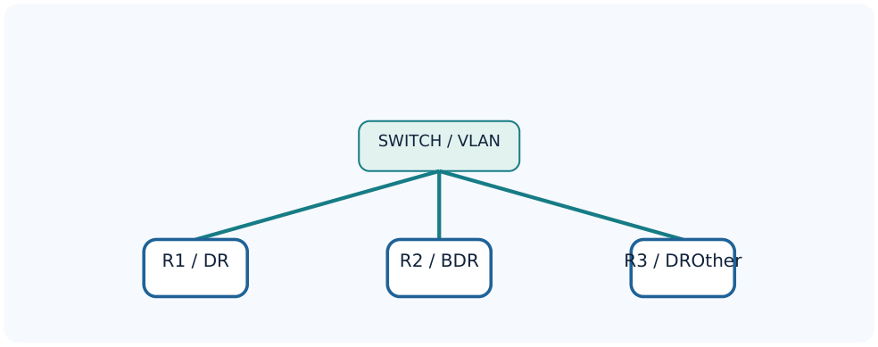

*Rysunek 8. Segment Ethernet z przykładowymi rolami DR, BDR i DROther.*

### 3.7. Typy sieci OSPF

broadcast — typowe wspólne Ethernet/VLAN, wybór DR/BDR; ptp — dwa routery na jednym łączu, bez
DR/BDR; ptmp — zestaw połączeń point-to-point; nbma — wielodostęp bez naturalnego broadcast,
może wymagać statycznych sąsiadów. Typy muszą odpowiadać rzeczywistej topologii.

##

4. Obszary OSPF

OSPF pozwala rozdzielić domenę routingu na obszary (areas). Podział ogranicza zakres
rozpowszechniania części informacji topologicznych i liczbę przeliczeń SPF. Podstawowym obszarem
jest Area 0, inaczej backbone. Pozostałe obszary są z nim związane przez routery graniczne ABR.

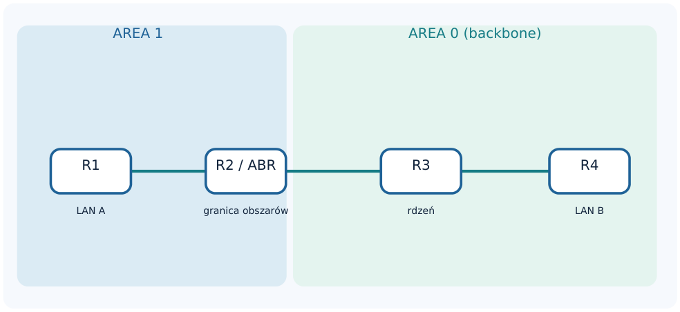

*Rysunek 9. R2 jest ABR: posiada interfejsy OSPF w Area 1 oraz Area 0.*

| Element | Znaczenie |
| --- | --- |
| Area 0 / 0.0.0.0 | obszar szkieletowy OSPF |
| Internal router | wszystkie aktywne interfejsy OSPF w jednym obszarze |
| ABR | Area Border Router — łączy obszary |
| ASBR | Autonomous System Boundary Router — wprowadza trasy zewnętrzne |
| Stub | ogranicza propagację zewnętrznych LSA Type 5 |
| NSSA | dopuszcza lokalne trasy zewnętrzne przez LSA Type 7 |

### 4.1. Najważniejsze typy LSA

| Typ | Nazwa / rola |
| --- | --- |
| 1 | Router LSA — informacje o routerze i łączach wewnątrz obszaru |
| 2 | Network LSA — segment wielodostępowy reprezentowany przez DR |
| 3 | Summary LSA — przekazywanie prefiksów między obszarami |
| 4 | ASBR Summary — informacja o osiągalności ASBR |
| 5 | AS External — trasy zewnętrzne do domeny OSPF |
| 7 | NSSA External — lokalne trasy zewnętrzne NSSA |

### 4.2. Trasy zewnętrzne E1 oraz E2

Dla E1 koszt obejmuje zarówno koszt zewnętrzny, jak i wewnętrzny koszt dojścia do ASBR. W E2
podstawową wartością jest metryka zewnętrzna; wewnętrzny koszt może rozstrzygać między równymi
kandydatami. Redystrybucji nie należy uruchamiać bez planu, ponieważ może prowadzić do pętli i
ponownego wprowadzania tras.

##

5. OSPF w MikroTik RouterOS v7

Konfigurację buduje się w kolejności: Instance → Area → Interface Template. Obiekty Interface, Neighbor
oraz LSA pokazują aktualny stan protokołu. W RouterOS v7 prawidłowa właściwość dopasowania
prefiksu w OSPF Interface Template to network (liczba pojedyncza), a nie „networks”.

### 5.1. Tworzenie instancji

```routeros
/routing ospf instance
add name=OSPF1 version=2 router-id=1.1.1.1
```

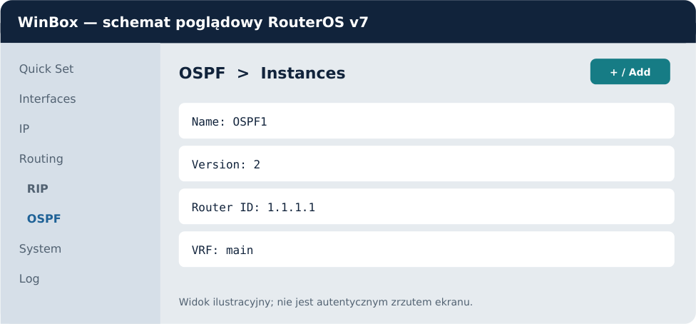

*Rysunek 10. Poglądowy odpowiednik WinBox: Routing → OSPF → Instances.*

### 5.2. Tworzenie obszaru

```routeros
/routing ospf area
add name=BACKBONE area-id=0.0.0.0 instance=OSPF1
```

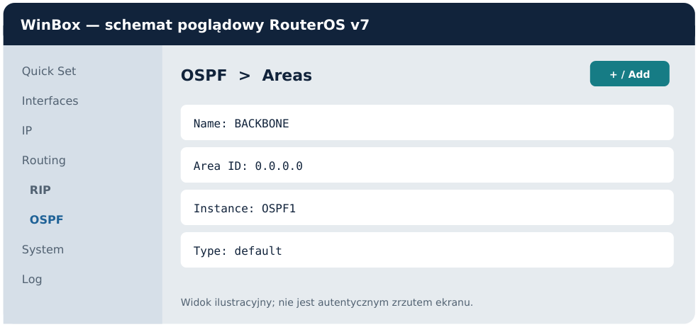

*Rysunek 11. Poglądowy odpowiednik WinBox: Routing → OSPF → Areas.*

### 5.3. Łącze tranzytowe i LAN pasywny

```routeros
/routing ospf interface-template
add interfaces=ether2 area=BACKBONE type=ptp cost=10
add interfaces=ether1 area=BACKBONE passive
```

Interfejs passive nie wysyła ani nie odbiera pakietów OSPF. Pozwala objąć lokalną sieć domeną OSPF
bez tworzenia niepotrzebnego sąsiedztwa z komputerami. Można dopasować interfejs po nazwie albo
po network= z prefiksem adresowym.

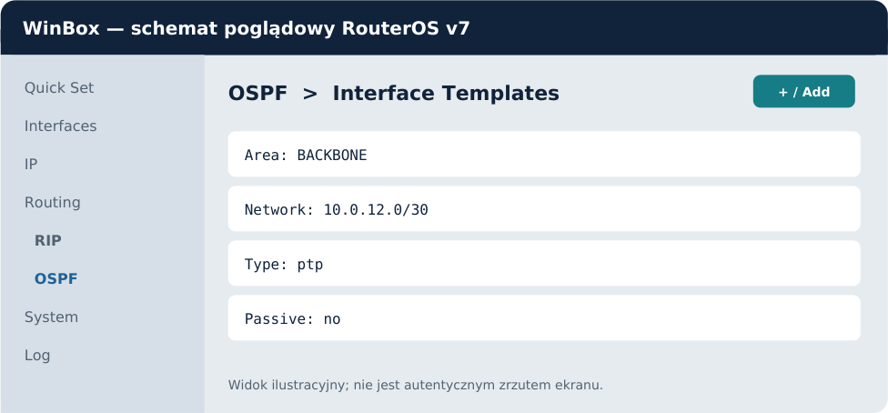

*Rysunek 12. Poglądowy odpowiednik WinBox: Routing → OSPF → Interface Templates.*

### 5.4. Laboratorium OSPF: dwa routery i dwie sieci LAN

Pierwszy router posiada LAN 192.168.10.0/24, drugi 192.168.20.0/24. Pomiędzy nimi znajduje się łącze
10.0.12.0/30. Na interfejsach między routerami używamy network type ptp; w LAN ustawiamy passive.

| Router | Port | Adres |
| --- | --- | --- |
| R1 | ether1 (LAN) | 192.168.10.1/24 |
| R1 | ether2 (R2) | 10.0.12.1/30 |
| R2 | ether1 (R1) | 10.0.12.2/30 |
| R2 | ether2 (LAN) | 192.168.20.1/24 |

### R1 — pełna konfiguracja

```routeros
/ip address
add address=192.168.10.1/24 interface=ether1
add address=10.0.12.1/30 interface=ether2
/routing ospf instance
add name=OSPF1 version=2 router-id=1.1.1.1
/routing ospf area
add name=BACKBONE area-id=0.0.0.0 instance=OSPF1
/routing ospf interface-template
add interfaces=ether2 area=BACKBONE type=ptp
add interfaces=ether1 area=BACKBONE passive
```

### R2 — pełna konfiguracja

```routeros
/ip address
add address=10.0.12.2/30 interface=ether1
add address=192.168.20.1/24 interface=ether2
/routing ospf instance
add name=OSPF1 version=2 router-id=2.2.2.2
/routing ospf area
add name=BACKBONE area-id=0.0.0.0 instance=OSPF1
/routing ospf interface-template
add interfaces=ether1 area=BACKBONE type=ptp
add interfaces=ether2 area=BACKBONE passive
```

### Oczekiwany rezultat

Na R1 powinien pojawić się sąsiad o Router ID 2.2.2.2 w stanie Full i trasa do 192.168.20.0/24.
Analogicznie R2 uczy się 192.168.10.0/24. Komputery w obu sieciach LAN wymagają poprawnych bram
domyślnych i ewentualnych reguł firewall.

```routeros
/routing ospf interface print detail
/routing ospf neighbor print detail
/routing ospf lsa print
/routing route print detail
/ping 192.168.20.1 src-address=192.168.10.1
```

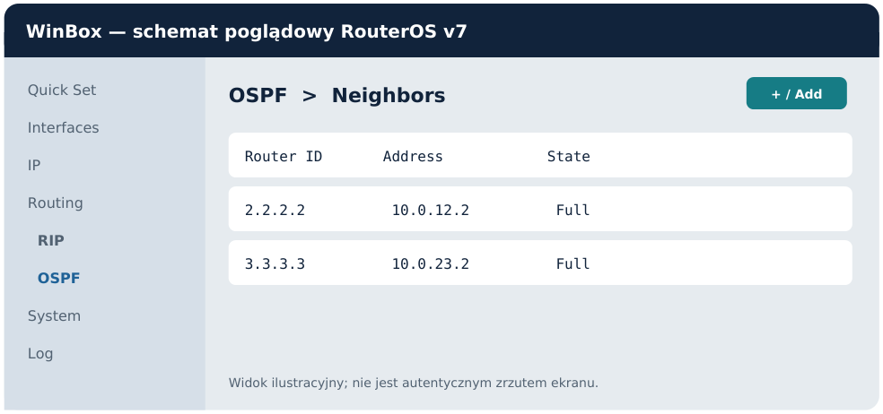

*Rysunek 13. Poglądowy odpowiednik WinBox: obserwacja sąsiadów OSPF (przykładowe dane).*

### 5.5. Laboratorium OSPF: trzy routery

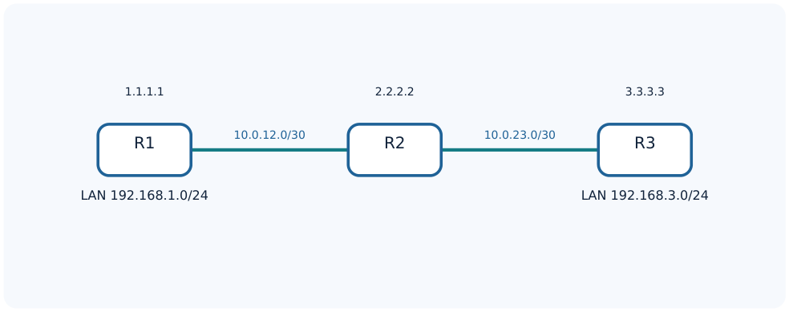

*Rysunek 14. Układ R1–R2–R3, używany do sprawdzenia routingu wieloskokowego.*
Należy skonfigurować routery z adresacją identyczną jak w laboratorium RIP. Następnie na każdym
routerze utworzyć własną instancję OSPFv2 z unikatowym Router ID, wspólnym Area 0 oraz szablonami
typu ptp na łączach R1–R2 i R2–R3. Sieci LAN należy ustawić jako passive. Uczniowie powinni
potwierdzić na R1 trasę do 192.168.3.0/24 i na R3 trasę do 192.168.1.0/24.

#### R2 po skonfigurowaniu adresów IP

```routeros
/routing ospf instance
add name=OSPF1 version=2 router-id=2.2.2.2
/routing ospf area
add name=BACKBONE area-id=0.0.0.0 instance=OSPF1
/routing ospf interface-template
add interfaces=ether1 area=BACKBONE type=ptp
add interfaces=ether2 area=BACKBONE type=ptp
```

### 5.6. Multi-area i ABR

W drugim etapie można przenieść łącze R1–R2 do Area 1, pozostawiając R2–R3 w Area 0. R2 staje się
ABR. Na R1 należy utworzyć Area 1 i przypisać do niej odpowiedni interfejs; na R2 trzeba utworzyć
obydwa obszary i dopasować interfejsy. Area 0 pozostaje rdzeniem międzyobszarowym.

#### R2 — konfiguracja obszaru dodatkowego

```routeros
/routing ospf area
add name=AREA1 area-id=0.0.0.1 instance=OSPF1
/routing ospf interface-template
add interfaces=ether1 area=AREA1 type=ptp
add interfaces=ether2 area=BACKBONE type=ptp
```

Przed zastosowaniem powyższego fragmentu usuń wcześniejszy szablon obejmujący ether1 w Area 0.
Nie należy tworzyć dwóch nakładających się szablonów dla tego samego interfejsu. Tak samo należy
odpowiednio zmienić konfigurację R1.

### 5.7. Trasa domyślna i redystrybucja

```routeros
/routing ospf instance
set [find name=OSPF1] originate-default=if-installed
```

Tryb if-installed pozwala rozgłaszać 0.0.0.0/0 pod warunkiem zainstalowania takiej trasy. Redystrybucja
statycznych lub connected wymaga osobnej decyzji projektowej i odpowiednich filtrów. Brak
zaplanowanej polityki importu/eksportu jest częstą przyczyną błędów routingu.

## 5A. Interfejs loopback w OSPF i MikroTik RouterOS v7

Interfejs loopback jest logicznym interfejsem routera, niezwiązanym z konkretnym gniazdem Ethernet. Jego
adres IP pozostaje dostępny lokalnie nawet wtedy, gdy fizyczne łącze zostanie odłączone. Dostępność
loopbacku z innych routerów zależy jednak od istnienia działającej ścieżki routingu.

### 5A.1. Po co stosuje się loopback?

Stabilny adres zarządzania. Administrator może łączyć się z routerem za pomocą jednego adresu
niezależnego od konkretnego łącza, o ile istnieje co najmniej jedna działająca droga do routera.
Identyfikacja protokołów. Adres loopbacku jest wygodnym, stabilnym kandydatem na OSPF Router ID, adres
źródłowy sesji administracyjnych oraz punkt końcowy innych usług.
Testowanie routingu. Ping i traceroute pomiędzy loopbackami pokazują, czy domena OSPF poprawnie
rozgłasza i instaluje trasy hostowe /32.

### 5A.2. Router ID to nie to samo co IP loopbacku

OSPF Router ID jest 32-bitowym identyfikatorem procesu OSPF, zwyczajowo zapisywanym jak IPv4. Nie jest
sam w sobie adresem docelowym służącym do komunikacji. Aby adres 10.255.0.1 był osiągalny, musi istnieć
na interfejsie i musi być znana trasa do 10.255.0.1/32. Router ID można nadać ręcznie; nie wymaga to
przypisania identycznego IP do żadnego interfejsu.

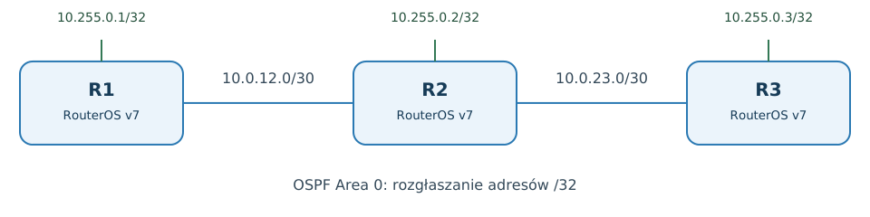

*Rysunek 16. Trzy routery z adresami loopback /32 oraz dwiema sieciami tranzytowymi.*

### 5A.3. Plan adresacji

| Router | Loopback /32 | Router ID | Połączenie tranzytowe |
| --- | --- | --- | --- |
| R1 | 10.255.0.1/32 | 10.255.0.1 | 10.0.12.1/30 |
| R2 | 10.255.0.2/32 | 10.255.0.2 | 10.0.12.2/30; 10.0.23.1/30 |
| R3 | 10.255.0.3/32 | 10.255.0.3 | 10.0.23.2/30 |

### 5A.4. Tworzenie loopbacku w RouterOS v7

W RouterOS v7 można spotkać wbudowany interfejs lo. Najpierw należy sprawdzić listę interfejsów. Jeżeli lo
jest dostępny, przypisujemy mu adres IP. Dokumentacja MikroTik opisuje również klasyczną metodę
wykorzystującą pusty bridge, szczególnie przydatną przy starszych wydaniach i w niektórych przykładach
konfiguracji.

```routeros
/interface print
/interface print where name="lo"
```

Wariant A: dostępny interfejs lo

```routeros
/ip address add address=10.255.0.1/32 interface=lo
/ip address print where interface=lo
```

Wariant B: pusty bridge jako loopback

```routeros
/interface bridge add name=loopback protocol-mode=none
/ip address add address=10.255.0.1/32 interface=loopback
/interface bridge port print where bridge=loopback
```

W wariancie B nie dodajemy do bridge żadnych portów. W przykładach polecenia należy zastąpić adres
10.255.0.1/32 odpowiednią wartością dla R2 lub R3. Nie tworzymy jednocześnie obu wariantów z takim
samym adresem.

### 5A.5. Router ID i rozgłaszanie loopbacku przez OSPF

Samo ustawienie router-id na 10.255.0.1 nie rozgłasza automatycznie sieci 10.255.0.1/32. W OSPF należy
dodatkowo dołączyć interfejs loopback jako passive do właściwego obszaru. Nie tworzymy na nim
sąsiedztwa; chcemy jedynie, aby prefiks /32 znalazł się w informacjach o osiągalnych sieciach.

```routeros
/routing ospf instance
add name=OSPF1 version=2 router-id=10.255.0.1
/routing ospf area
add name=BACKBONE area-id=0.0.0.0 instance=OSPF1
/routing ospf interface-template
add area=BACKBONE network=10.0.12.0/30 type=ptp
add area=BACKBONE interfaces=lo passive
```

Dla wariantu z pustym bridge ostatni wiersz powinien mieć interfaces=loopback. Na R2 i R3 należy użyć
właściwych Router ID, adresów /32 oraz sieci tranzytowych. Przy powtarzaniu eksperymentu na już
skonfigurowanym OSPF aktualizujemy istniejącą instancję zamiast tworzyć drugą z tym samym
przeznaczeniem.

### 5A.6. Odpowiednik WinBox

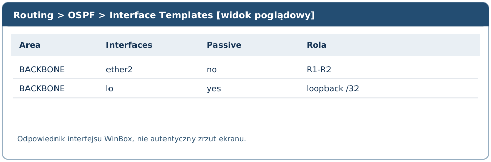

*Rysunek 17. Widok poglądowy: szablon loopbacku musi być pasywny.*

### 5A.7. Kompletny przykład: R1, R2 i R3

Poniższa konfiguracja zakłada, że adresy tranzytowe zostały wcześniej przypisane do interfejsów według
tabeli z rozdziału 5A.3. Na wszystkich routerach dostępny jest lo. Polecenia pokazują niezależną konfigurację dla każdego
routera. Uruchamiamy je na odpowiednich urządzeniach, zaczynając od czystej konfiguracji OSPF.

#### Router R1

```routeros
/ip address add address=10.255.0.1/32 interface=lo
/routing ospf instance add name=OSPF1 version=2 router-id=10.255.0.1
/routing ospf area add name=BACKBONE instance=OSPF1 area-id=0.0.0.0
/routing ospf interface-template
add area=BACKBONE network=10.0.12.0/30 type=ptp
add area=BACKBONE interfaces=lo passive
```

#### Router R2

```routeros
/ip address add address=10.255.0.2/32 interface=lo
/routing ospf instance add name=OSPF1 version=2 router-id=10.255.0.2
/routing ospf area add name=BACKBONE instance=OSPF1 area-id=0.0.0.0
/routing ospf interface-template
add area=BACKBONE network=10.0.12.0/30 type=ptp
add area=BACKBONE network=10.0.23.0/30 type=ptp
add area=BACKBONE interfaces=lo passive
```

#### Router R3

```routeros
/ip address add address=10.255.0.3/32 interface=lo
/routing ospf instance add name=OSPF1 version=2 router-id=10.255.0.3
/routing ospf area add name=BACKBONE instance=OSPF1 area-id=0.0.0.0
/routing ospf interface-template
add area=BACKBONE network=10.0.23.0/30 type=ptp
add area=BACKBONE interfaces=lo passive
```

### 5A.8. Diagnostyka

```routeros
/ip address print
/routing ospf interface print detail
/routing ospf neighbor print detail
/routing ospf lsa print
/routing route print detail
/ping 10.255.0.3 src-address=10.255.0.1
/tool traceroute 10.255.0.3 src-address=10.255.0.1
```

Na R1 oczekujemy trasy OSPF do 10.255.0.3/32 ze wskazaniem następnego routera R2. Na R3 analogicznie
powinna występować trasa do 10.255.0.1/32. Weryfikujemy trasę, źródło trasy oraz wynik pinga ze
wskazanym adresem źródłowym.

### 5A.9. Stabilność i scenariusz awarii

Loopback jest stabilny jako lokalny interfejs logiczny, ale nie zapewnia zapasowej drogi. W topologii liniowej
R1–R2–R3 zerwanie jedynego łącza R2–R3 sprawi, że R1 nie osiągnie loopbacku R3. Po powstaniu
alternatywnego połączenia OSPF może przełączyć trasę, zachowując docelowy adres loopback.

#### Ćwiczenie A — awaria łącza bez zapasu

1. Potwierdź Full na połączeniach R1–R2 i R2–R3.
2. Uruchom ping z R1 do 10.255.0.3.
3. Wyłącz interfejs R2
prowadzący do R3.
4. Zapisz stan sąsiedztwa, trasę do 10.255.0.3/32 i wynik pinga.
5. Włącz interfejs i
obserwuj ponowną konwergencję.

#### Ćwiczenie B — dodanie alternatywnej drogi

Dodaj osobne połączenie między R1 i R3, np. 10.0.13.0/30, i włącz na nim OSPF. Dobierz koszty tak, aby
domyślnie ruch przechodził przez R2. Po odłączeniu R2–R3 sprawdź, czy ruch do 10.255.0.3/32 jest
kierowany przez R1–R3. Zanotuj zmiany tras i czasy przełączenia.

### 5A.10. Typowe błędy

Router ID bez adresu: identyfikator jest ustawiony, ale brak IP /32 na loopbacku; ping pod Router ID nie musi
działać.
Adres /32 bez reklamy: IP jest lokalnie skonfigurowany, lecz pozostałe routery nie mają trasy do /32.
Loopback niepasywny: na interfejsie logicznym nie ma potrzeby wymiany Hello ani tworzenia sąsiadów
OSPF.
Zduplikowany Router ID: dwa routery mają ten sam identyfikator; należy każdemu nadać unikalny.
Mylenie odporności interfejsu z odpornością sieci: adres logiczny pozostaje na routerze, ale komunikacja
wymaga drogi przez działające łącza.

### 5A.11. Pytania kontrolne

1. Czym różni się Router ID od adresu IP loopbacku?
2. Dlaczego dla loopbacku stosujemy często maskę /32?
3. Co oznacza passive w szablonie OSPF?
4. Dlaczego loopback nie gwarantuje łączności po awarii jedynego
łącza?
5. Jak sprawdzić obecność trasy do /32 na odległym routerze?
6. Jaką korzyść daje loopback w sieci
mającej redundantne ścieżki?

#### Źródła techniczne

MikroTik: dokumentacja OSPF, Interface Templates oraz przykłady LDP i EVPN. Przed wdrożeniem należy zweryfikować
składnię na konkretnej wersji RouterOS v7.

##

6. Diagnostyka, bezpieczeństwo i dobre praktyki

### 6.1. Diagnostyka krok po kroku

W pierwszej kolejności należy zweryfikować fizyczny stan interfejsów, konfigurację IP i komunikację z
sąsiadem. Następnie sprawdzić instancję, area, szablony, dynamiczne interfejsy OSPF, stan sąsiedztwa,
LSDB oraz końcową tablicę routingu. Stan Full dowodzi synchronizacji adjacency, ale nie gwarantuje, że
każda oczekiwana sieć została poprawnie rozgłoszona.

```routeros
/interface print
/ip address print
/ping 10.0.12.2
/routing ospf instance print detail
/routing ospf area print detail
/routing ospf interface-template print detail
/routing ospf interface print detail
/routing ospf neighbor print detail
/routing ospf lsa print
/routing route print detail
```

| Objaw | Pierwsze kontrole |
| --- | --- |
| Nie ma sąsiada | łącze, IP, firewall IP protocol 89, area, passive |
| Sąsiad w Init | wymiana Hello, komunikacja dwukierunkowa |
| Sąsiad w ExStart / Exchange | MTU, zgodność parametrów, typ sieci |
| Sąsiad Full, ale brak trasy | prefiks LAN, LSA, filtry, konkurencyjna trasa |
| RIP nie otrzymuje tras | UDP 520, template, multicast, redystrybucja |

### 6.2. Firewall i separacja protokołów

OSPF korzysta z protokołu IP 89, a RIP z UDP 520. W regułach zapory nie wolno utożsamiać „IP protocol
89” z „TCP port 89” lub „UDP port 89”. Ruch routingu dopuszczamy jedynie na zaufanych segmentach,
na których są rzeczywiści sąsiedzi. Nie należy przypadkowo aktywować RIP/OSPF od strony publicznej
sieci WAN.

### 6.3. Uwierzytelnianie

OSPFv2 w RouterOS v7 obsługuje m.in. simple, MD5 i SHA-256. Po obu stronach łącza należy użyć
zgodnej metody i klucza. Uwierzytelnianie ogranicza ryzyko nawiązania sąsiedztwa przez
nieuprawniony router, lecz nie zastępuje odseparowania interfejsów i reguł firewall. W RIP dostępne są
odpowiednio hasło proste i key-chain MD5.

```routeros
/routing ospf interface-template
add interfaces=ether2 area=BACKBONE type=ptp auth=sha256 auth-id=1 \
    authentication-key="HasloLaboratorium"
```

### 6.4. Logowanie i zmiany topologii

```routeros
/system logging add topics=ospf
/system logging add topics=rip
/log print
```
Doświadczalnie można odłączyć łącze, zanotować zmianę neighbor/route i odtworzyć połączenie.
Zmiany należy przeprowadzać w odizolowanej sieci szkolnej, a nie na urządzeniach produkcyjnych.
Przed ćwiczeniami warto zapisać eksport konfiguracji i włączyć Safe Mode w terminalu RouterOS.

## 7. RIP a OSPF — porównanie

| Właściwość | RIPv2 | OSPFv2 |
| --- | --- | --- |
| Rodzaj | distance-vector | link-state |
| Metryka | hop count | cost |
| Limit 15 skoków | tak | nie |
| Wiedza o topologii | wektor odległości | LSDB i SPF |
| Transport | UDP / 520 | IP protocol 89 |
| Multicast | 224.0.0.9 | 224.0.0.5 i .6 |
| Hierarchia | brak obszarów | obszary, Area 0 |
| DR / BDR | nie | broadcast/NBMA |
| Skalowalność | niewielka | znacznie większa |
| Typowe zastosowanie | nauka, małe / starsze sieci | sieci organizacji i operatorów |

## 8. Ćwiczenia i zadania praktyczne

### Ćwiczenie 1. RIPv2: rozgłaszanie trasy

Zbuduj topologię R1–R2–R3, skonfiguruj adresację i RIPv2. Udokumentuj tabele routingu na R1 i R3 oraz
dwa testy ping. Następnie wyłącz łącze R2–R3 i opisz, co dzieje się z trasą do LAN R3.

### Ćwiczenie

2. OSPFv2: sąsiedztwo Full

Na dwóch routerach skonfiguruj OSPFv2 w Area 0. Sprawdź w WinBox i terminalu stan Full, następnie
zapisz poznane prefiksy. Wyjaśnij rolę interface-template oraz passive.

### Ćwiczenie

3. Zmiana cost

W topologii z dwiema alternatywnymi ścieżkami nadaj takie koszty interfejsów, aby preferowana była
trasa dłuższa pod względem liczby routerów. Potwierdź wybór przy pomocy /routing route print detail
oraz traceroute.

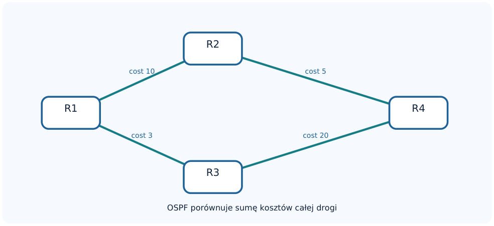

*Rysunek 15. Topologia do ćwiczenia porównującego wybór tras RIP i OSPF.*

### Ćwiczenie

4. Wybory DR i BDR

Podłącz trzy routery do wspólnego VLAN-u. Sprawdź wybory DR/BDR. Zmień priority, pamiętając, że
wybór nie jest automatycznie wywłaszczany przez router o wyższym priorytecie już po ustaleniu DR.
Powtórz eksperyment od nowej elekcji i opisz wynik.

### Ćwiczenie

5. OSPF Multi-area

Skonfiguruj R1–R2 w Area 1 i R2–R3 w Area 0. Potwierdź rolę ABR i poznane trasy. Zestaw informacje
dostępne w LSDB routera R1 i R3.

## 9. Pytania kontrolne

1. Czym różni się routing statyczny od dynamicznego?
2. Co oznaczają RIB i FIB?
3. Dlaczego w tablicy może znajdować się kilka tras do jednego prefiksu?
4. Jaka jest różnica między distance a metric?
5. Jak RIP określa najlepszą trasę?
6. Dlaczego metryka 16 w RIP oznacza brak osiągalności?
7. Czym są split horizon i poison reverse?
8. Jaki port i multicast wykorzystuje RIPv2?
9. Czym różnią się RIPv1 i RIPv2?
10. Co oznaczają LSA i LSDB?
11. Jak działa algorytm SPF?
12. Jaki jest numer protokołu IP OSPF?
13. W jakim celu przesyła się Hello?
14. Jakie są pięć typów pakietów OSPF?
15. Kiedy stan 2-Way jest prawidłowy?
16. Co oznacza Full?

17. Do czego służą DR i BDR?
18. Co oznacza priority=0?
19. Kiedy zaleca się network type ptp?
20. Czym jest backbone Area 0?
21. Jaka jest różnica między ABR i ASBR?
22. Na czym polega passive interface?
23. Jak w RouterOS v7 skonfigurować instancję, area i template?
24. Jak sprawdzić sąsiadów oraz LSDB?
25. Dlaczego Full nie musi oznaczać poprawnego routingu do każdego LAN?
26. Jak odróżnić błąd adresacji IP od błędu samego protokołu?

## 10. Zestaw komend do powtórzenia

#### RIP

```routeros
/routing rip instance print detail
/routing rip interface-template print detail
/routing rip interface print
/routing rip neighbor print detail
# OSPF
/routing ospf instance print detail
/routing ospf area print
/routing ospf interface-template print detail
/routing ospf interface print detail
/routing ospf neighbor print detail
/routing ospf lsa print
# Routing i testy
/routing route print detail
/ip route print
/ping 10.0.12.2
/tool traceroute 192.168.3.1
```

## 11. Źródła i dokumentacja techniczna

- [MikroTik RouterOS v7 — OSPF (dokumentacja CLI)](https://manual.mikrotik.com/docs/cli-reference/routing/ospf/)
- [MikroTik RouterOS v7 — RIP (dokumentacja CLI)](https://manual.mikrotik.com/docs/cli-reference/routing/rip/)
- [MikroTik — OSPF, opis protokołu](https://help.mikrotik.com/docs/spaces/ROS/pages/9863229/OSPF)
- [RFC 2453 — RIP Version 2](https://www.rfc-editor.org/rfc/rfc2453)
- [RFC 2328 — OSPF Version 2](https://www.rfc-editor.org/rfc/rfc2328)

**Uwagi do ilustracji i poleceń.** Wszystkie widoki WinBox przedstawione w niniejszym opracowaniu są schematami poglądowymi, a nie autentycznymi zrzutami z uruchomionego programu. Mogą się różnić wizualnie od konkretnej wersji WinBox. Polecenia odnoszą się do RouterOS v7; przed wykonaniem laboratoryjnym należy zweryfikować dostępność danej funkcji w zainstalowanym wydaniu.

