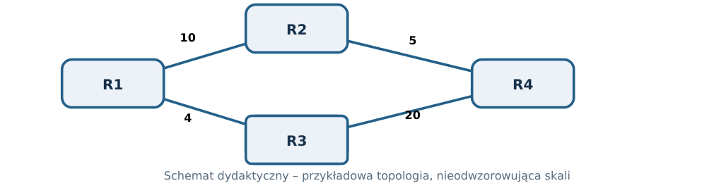
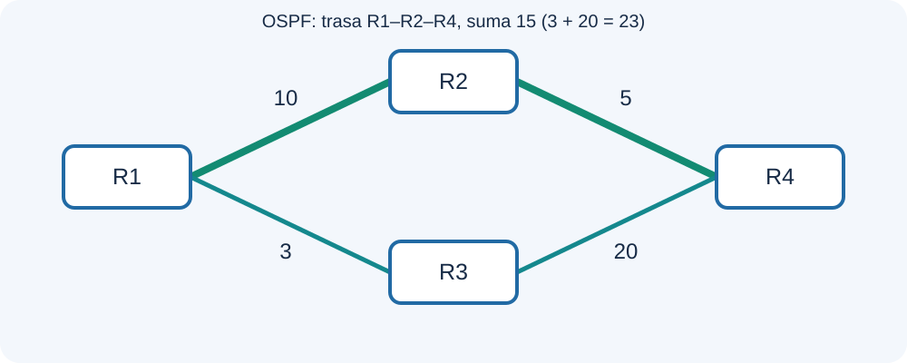
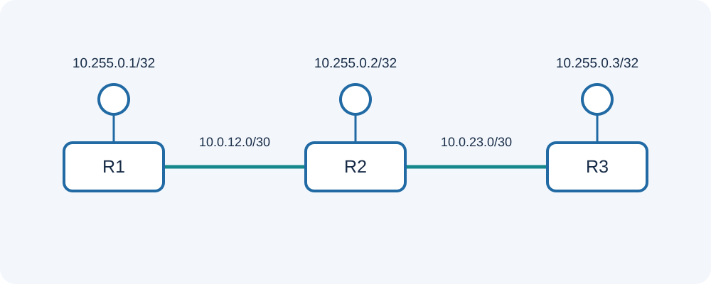
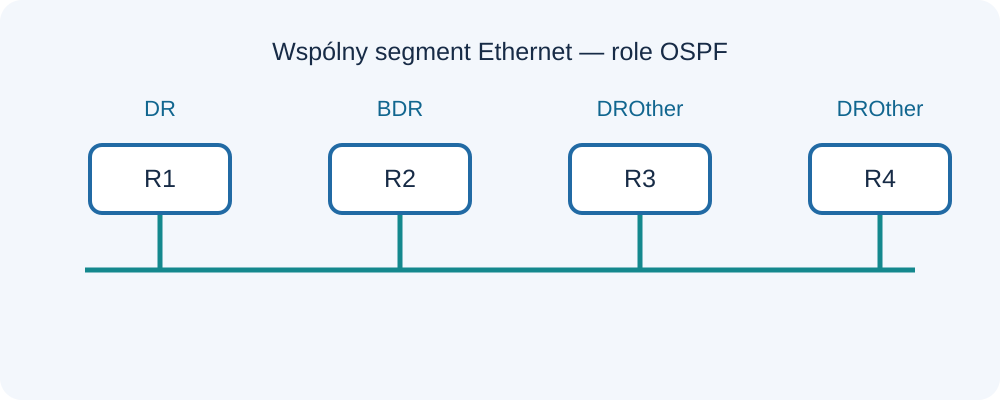
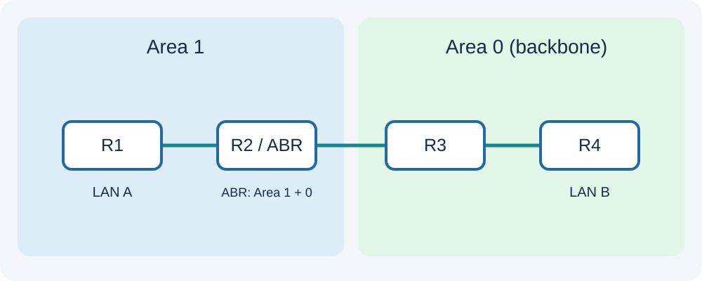

[← Sieci komputerowe](README.md) · [RIP](RIP.md) · [OSPF](OSPF.md) · [MikroTik](MikroTik_RIP_OSPF_RouterOS_v7.md)

# OSPF wszystkie wersje

**PDF:** [Pobierz dokument](https://github.com/tomaszmakaedu/materialy-dydaktyczne/raw/refs/heads/main/ZSEM/Klasa%204/Sieci%20komputerowe/Skrypt_OSPF_wszystkie_wersje.pdf) · **Autor:** Tomasz Mąka · **ZSEM, klasa 4t**

> Ilustracje zamieszczono poniżej; pełny układ materiału jest dostępny także w PDF.

## OSPFv1 · OSPFv2 · OSPFv3 | SPF, LSA, LSDB, obszary i loopback

Kompletny skrypt teoretyczny dla klasy IV technikum – technik teleinformatyk. Materiał niezależny od
producenta routera, przeznaczony do nauki, analizy topologii i powtórzeń.
Autor materiału: Tomasz Mąka | ZSEM

## Cele i sposób korzystania ze skryptu

Uczeń powinien wyjaśniać zjawiska, analizować tablice routingu i przewidywać zachowanie sieci po
zmianie topologii. Opisane wartości domyślne mogą zależeć od typu sieci, specyfikacji i implementacji.
Przykładowe topologie mają charakter dydaktyczny.

## Spis zagadnień

1. Geneza OSPF i rola w sieciach IP
2. OSPFv1, OSPFv2 i OSPFv3
3. Link-state, graf sieci i LSDB
4. Dijkstra SPF: algorytm krok po kroku
5. Cost, trasy równorzędne i asymetria
6. Router ID i stabilność identyfikacji
7. Loopback: interfejs logiczny a Router ID
8. Transport pakietów i pięć typów wiadomości
9. Hello, timery i dwukierunkowość
10. Maszyna stanów Neighbor/Adjacency
11. Typy sieci OSPF i wybór modelu sąsiedztwa
12. DR, BDR i DROther
13. LSA, LSDB i flooding
14. Typy LSA OSPFv2
15. OSPFv3 i przeprojektowanie LSA
16. Area 0, ABR, ASBR i hierarchia OSPF
17. Stub, Totally Stubby, NSSA i zakres LSA
18. Routing intra-area, inter-area i zewnętrzny
19. Summarization, Area Range i virtual link
20. OSPFv3: IPv6, Instance ID i Address Families
21. Bezpieczeństwo OSPFv2 i OSPFv3
22. Konwergencja, awarie i testowanie odporności
23. Diagnostyka stanów, tras i LSA
24. Projektowanie sieci OSPF i dobre praktyki

## 1. Geneza OSPF i rola w sieciach IP

Open Shortest Path First (OSPF) to wewnętrzny protokół routingu typu link-state. Powstał jako odpowiedź
na ograniczenia prostszych protokołów distance-vector: ma skalować się na większe topologie, szybciej
reagować na zmiany i umożliwiać hierarchiczny podział domeny routingu.
OSPF nie rozgłasza co 30 sekund całej tablicy do każdego sąsiada na sposób RIP. Routery
rozpowszechniają informacje o stanie łączy w postaci LSA, synchronizują odpowiednie bazy LSDB i
niezależnie wyznaczają drogi za pomocą algorytmu SPF.
OSPF jest protokołem IGP działającym wewnątrz wspólnej domeny administracyjnej. Nie pełni tej samej
roli co BGP, służący głównie do wymiany polityk routingu pomiędzy systemami autonomicznymi.

### Do zapamiętania

- Link-state oznacza opis topologii i samodzielne obliczanie drogi, nie tylko „szybszy RIP”.

## 2. OSPFv1, OSPFv2 i OSPFv3

Historyczny OSPFv1 został opisany w RFC 1131. Następnie rozwijano OSPFv2 dla IPv4, którego kluczową
specyfikacją jest RFC 2328. OSPFv3 powstał przede wszystkim dla IPv6 (RFC 5340, zastępujący RFC
2740), ale rozszerzenie RFC 5838 umożliwiło obsługę wielu rodzin adresów, w tym IPv4.
OSPFv1 ma znaczenie historyczne i nie należy go traktować jako współczesnego standardu
wdrożeniowego. OSPFv2 i OSPFv3 współistnieją, mają podobną filozofię SPF i obszarów, lecz różnią się
identyfikacją interfejsów, zawartością LSA i ochroną pakietów.
Sformułowanie „OSPFv3 = tylko IPv6” jest zatem uproszczeniem: zależy od implementacji i
obsługiwanych Address Families. OSPFv3 może przenosić także trasy IPv4, mimo że pakiety sterujące są
transportowane z wykorzystaniem IPv6.

## 3. Link-state, graf sieci i LSDB

Router opisuje własne połączenia i stan odpowiednich segmentów. Te informacje rozgłaszane są innym
uczestnikom właściwego obszaru. Zestaw poznanych LSA tworzy LSDB – Link State Database. Routery w
obrębie tego samego obszaru powinny posiadać zgodną wiedzę o jego topologii.
Graf opisuje sieć jako wierzchołki (routery lub pseudowęzły sieci wielodostępowych) oraz krawędzie z
kosztami. Każdy router może odtworzyć najkrótsze drogi z własnego punktu widzenia. To dlatego dwaj
routerzy mogą mieć różne drzewka SPF, choć korzystają z tej samej topologii.
LSDB nie jest tablicą routingu: pierwsza zawiera opis topologii, druga – wybrane trasy do prefiksów. Nie
wszystkie informacje LSDB stają się aktywnymi wpisami w FIB.

### Przykład krok po kroku

R1 posiada informację, że istnieje R2, R3 i R4 oraz łącza R1–R2 koszt 10, R1–R3 koszt 4, R2–R4 koszt 5 i
R3–R4 koszt 20. Z tej wiedzy sam wylicza koszt 15 przez R2 zamiast 24 przez R3.

## 4. Dijkstra SPF: algorytm krok po kroku

SPF (Shortest Path First) wykorzystuje wariant algorytmu Dijkstry. Punktem wyjścia jest własny router
jako korzeń drzewa. Początkowo znany jest koszt 0 do samego siebie; koszty pozostałych wierzchołków
są nieokreślone. W kolejnych iteracjach wybiera się nieprzetworzony wierzchołek o najniższym koszcie i
sprawdza, czy prowadzi przez niego tańsza droga do jego sąsiadów.
Operacja porównania propozycji kosztów nazywa się relaksacją krawędzi. Po zakończeniu algorytmu
router zna najniższy koszt dojścia do osiągalnych elementów grafu i może określić następny skok.
Algorytm optymalizuje sumę przypisanych kosztów, nie liczbę przeskoków i nie rzeczywisty czas
transmisji pakietu. Jeżeli administrator źle dobrał wagi, SPF poprawnie obliczy najtańszą drogę według
nieprawidłowego modelu kosztów.

### Przykład krok po kroku

Graf: R1–R2 koszt 10, R1–R3 koszt 4, R2–R4 koszt 5, R3–R4 koszt 20. Iteracja 1: R1 ma 0, R2=10, R3=4.
Iteracja 2: wybór R3 (4), R4=24. Iteracja 3: wybór R2 (10), R4 zostaje poprawiony do 15. Iteracja 4: R4
(15) jest końcowy.
Najkrótsza trasa R1 → R2 → R4 kosztuje 15, mimo że początkowo znano drogę R1 → R3 → R4 o koszcie
24.

## 5. Cost, trasy równorzędne i asymetria

*Rysunek 1. OSPF wybiera trasę o niższym sumarycznym koszcie.*

Cost jest podstawową metryką OSPF. Zazwyczaj wiąże się z interfejsem wyjściowym i sumuje wzdłuż
drogi. Wiele implementacji może wyprowadzać koszt z przepustowości referencyjnej, ale nie ma jednej
uniwersalnej wartości kosztu dla każdego współczesnego łącza i producenta.
Jeżeli dwie ścieżki mają identyczny koszt, może zostać zastosowane ECMP (Equal-Cost Multi-Path). To
sposób korzystania z kilku następnych skoków; szczegóły równoważenia przepływów zależą od
implementacji i sprzętu.
Koszty w obu kierunkach nie muszą być równe. Router R1 może wybrać inny przebieg do R4 niż router
R4 podczas wysyłania pakietów do R1. Dlatego bada się zarówno drogę do celu, jak i drogę powrotną.

### Przykład krok po kroku

Droga A: 5+10+5 = 20. Droga B: 8+12 = 20. Obie są równokosztowe w rozumieniu OSPF.
Zmiana jednego cost z 12 na 13 sprawia, że ścieżka B ma koszt 21 i przestaje być równie dobra jak A.

## 6. Router ID i stabilność identyfikacji

Router ID (RID) jest 32-bitowym identyfikatorem OSPF zapisywanym w postaci czterech liczb
dziesiętnych, podobnie jak adres IPv4. W ramach właściwej domeny musi identyfikować router
jednoznacznie. RID nie jest sam w sobie trasą IPv4 i nie musi być osiągalnym adresem.
Sposób automatycznego wyznaczania RID różni się między systemami. W profesjonalnej sieci warto
stosować deterministyczną numerację, np. 1.1.1.1, 2.2.2.2 i 3.3.3.3, oraz konfigurować identyfikator
jawnie, jeśli platforma to umożliwia.
Zmiana Router ID może oznaczać konieczność przebudowy sąsiedztw i ponownego rozgłoszenia
informacji. Nie należy wykonywać jej bez analizy skutków dla działającej domeny.

## 7. Loopback: interfejs logiczny a Router ID

*Rysunek 2. Trzy adresy loopback /32 w topologii OSPF.*

Loopback to interfejs logiczny, którego działanie nie zależy wprost od stanu konkretnego kabla Ethernet.
Typowa adresacja loopback IPv4 to unikalny adres /32. W IPv6 często wykorzystuje się adres /128.
Loopback bywa punktem zarządzania, źródłem sesji i wygodnym adresem identyfikacyjnym.
Najważniejsza różnica: Router ID identyfikuje proces OSPF, natomiast loopback posiada rzeczywisty
adres IP. Ustawienie RID 1.1.1.1 nie tworzy automatycznie interfejsu 1.1.1.1/32, a dodanie /32 nie
oznacza, że wszyscy sąsiedzi od razu poznali drogę do tego adresu.
Adres loopback trzeba odpowiednio wprowadzić do routingu. Zazwyczaj robi się to bez tworzenia
niepotrzebnych sąsiedztw na samym loopbacku; interfejs może być pasywny. W OSPFv2 szczegóły
sposobu reprezentacji adresu mogą zależeć od typu interfejsu oraz implementacji.

### Przykład krok po kroku

R1 ma RID 1.1.1.1 oraz loopback 10.255.0.1/32; R2 ma RID 2.2.2.2 i loopback 10.255.0.2/32. Aby R1
mógł pingować 10.255.0.2, R2 musi rozgłosić prefiks, a R1 musi zainstalować trasę.
Awaria jednego Ethernetu nie powoduje automatycznego wyłączenia interfejsu loopback; trasa do niego
może jednak stać się niedostępna, jeśli zabraknie ścieżki w sieci.

### Do zapamiętania

- RID nie jest synonimem loopbacku.
- Stabilny adres nie oznacza gwarantowanej osiągalności w czasie awarii całej topologii.

## 8. Transport pakietów i pięć typów wiadomości

OSPF wykorzystuje numer protokołu IP 89, a nie port TCP ani UDP. OSPFv2 dla IPv4 korzysta m.in. z
multicastów 224.0.0.5 (AllSPFRouters) i 224.0.0.6 (AllDRouters). OSPFv3 wykorzystuje odpowiednie
multicast IPv6 FF02::5 i FF02::6.
Pięć typów pakietów to: Hello, Database Description (DD/DBD), Link State Request (LSR), Link State
Update (LSU) oraz Link State Acknowledgment (LSAck). Pakiet LSU może przenosić wiele LSA; LSA nie
należy mylić z odrębnym typem pakietu OSPF.
Nagłówki zawierają informacje pozwalające rozpoznać wersję, typ, identyfikator routera i obszar. W
OSPFv3 występuje dodatkowo Instance ID i zmieniony model uwierzytelniania.

### Do zapamiętania

- OSPF = IP protocol 89; „otwarcie UDP 89” nie rozwiąże problemu filtrowania OSPF.

## 9. Hello, timery i dwukierunkowość

Pakiety Hello wykrywają sąsiadów i umożliwiają stwierdzenie, że komunikacja jest dwukierunkowa.
Router porównuje parametry ważne dla wspólnego segmentu, w tym identyfikację obszaru, zgodność
wymaganych opcji oraz timery Hello/Dead zgodnie z daną wersją i typem sieci.
Często spotykane domyślne wartości na sieciach broadcast i point-to-point to Hello 10 s i Dead 40 s, ale
nie są uniwersalnymi ustawieniami każdego typu sieci ani producenta. Dla niektórych łączy NBMA
wartości mogą być inne.
Odebranie Hello nie dowodzi jeszcze pełnej synchronizacji bazy. W szczególności Init oznacza, że router
usłyszał sąsiada, lecz relacja dwukierunkowa nie została jeszcze potwierdzona.

### Przykład krok po kroku

R1 wysyła Hello z informacją o znanych sąsiadach. R2 odpowiada Hello zawierającym Router ID R1. R1
rozpoznaje dwukierunkową wymianę i osiąga etap 2-Way.

## 10. Maszyna stanów Neighbor/Adjacency

Typowe stany sąsiedztwa to Down, Attempt (istotny w wybranych typach sieci), Init, 2-Way, ExStart,
Exchange, Loading i Full. Nie każda para sąsiadów w sieci broadcast musi uzyskać Full, ponieważ relacje
z routerami DROther mogą pozostać w 2-Way.
W ExStart ustalane są parametry synchronizacji, w tym role master/slave przy wymianie DBD. W
Exchange porównywane są opisy LSDB, w Loading pobierane brakujące informacje, a Full oznacza
zakończenie synchronizacji adjacency.
Zatrzymanie w ExStart/Exchange może wskazywać m.in. problem MTU, niespójne parametry lub
interoperacyjność. Natomiast Full bez trasy może oznaczać brak właściwej reklamy prefiksu, filtrację albo
wybór innego źródła trasy.

### Przykład krok po kroku

Down: brak kontaktu. Init: otrzymane Hello. 2-Way: potwierdzona dwukierunkowość. ExStart/Exchange:
synchronizacja baz. Loading: brakujące LSA. Full: pełna adjacency.

### Do zapamiętania

- Full nie oznacza, że wszystkie prefiksy automatycznie trafiły do FIB.

## 11. Typy sieci OSPF i wybór modelu sąsiedztwa

Na segmencie broadcast wiele routerów może korzystać ze wspólnego Ethernetu; stosuje się tam wybór
DR i BDR. Na łączu point-to-point połączenie dotyczy dwóch routerów i wybór DR nie jest potrzebny.
NBMA (Non-Broadcast Multi-Access) opisuje sieci wielodostępowe bez klasycznego mechanizmu
broadcast, w których automatyczne wykrywanie sąsiadów może być niemożliwe. Point-to-Multipoint
modeluje zbiór połączeń punkt-punkt w obrębie określonej topologii.
Wybór typu sieci wpływa na sposób wykrywania sąsiadów, synchronizację, DR/BDR i reprezentację
topologii. Typ interfejsu fizycznego nie jest zawsze równoważny typowi sieci logicznej OSPF.

## 12. DR, BDR i DROther

*Rysunek 3. Role DR, BDR i DROther w segmencie broadcast.*

Na sieci wielodostępowej pełna synchronizacja każdego routera z każdym mogłaby prowadzić do wielu
relacji. Designated Router (DR) oraz Backup Designated Router (BDR) porządkują wymianę informacji.
Routery pozostałe nazywa się DROther.
W standardowym wyborze znaczenie mają priorytet OSPF i Router ID. Priorytet zero eliminuje możliwość
wyboru na DR/BDR. Wybór nie jest w zwykłym przypadku preempcyjny: dołączenie nowego routera z
wyższym priorytetem nie musi natychmiast odbierać istniejącemu DR roli.
DR to rola na konkretnym segmencie OSPF. Nie należy go utożsamiać z bramą domyślną, centralnym
routerem całej domeny ani ABR.

### Przykład krok po kroku

Na wspólnym Ethernet: R1 priorytet 1, R2 priorytet 100, R3 priorytet 0. Przy odpowiednim momencie
wyboru R2 może zostać DR; R3 nie może być DR ani BDR.

### Do zapamiętania

- Na typowym łączu point-to-point brak DR/BDR.

## 13. LSA, LSDB i flooding

LSA (Link State Advertisement) jest jednostką informacji o stanie topologii i tras. LSDB to zbiór LSA.
Mechanizm floodingu zapewnia rozpropagowanie zmian we właściwym zakresie. W nagłówkach LSA
znajdują się m.in. identyfikator LSA, router pochodzenia, numer sekwencyjny, wiek i suma kontrolna.
Numer sekwencyjny pomaga porównać świeżość informacji, a LS Age wiąże się z cyklem życia LSA.
Router musi oddzielić problem dostarczenia informacji od problemu przeliczenia SPF; odebranie jednego
pakietu nie oznacza natychmiastowej wymiany całej LSDB.
Flooding może mieć zasięg łącza, obszaru lub domeny w zależności od typu informacji i wersji OSPF.
Poprawne granice floodingu stanowią podstawę skalowania OSPF.

### Do zapamiętania

- LSA jest zawartością danych, LSU – pakietem niosącym LSA.

## 14. Typy LSA OSPFv2

W OSPFv2 podstawowe typy to: Type 1 Router-LSA, Type 2 Network-LSA, Type 3 Summary-LSA, Type 4
ASBR-Summary-LSA, Type 5 AS-External-LSA oraz Type 7 NSSA External-LSA. Poszczególne typy opisują
różne aspekty topologii i osiągalności.
Router-LSA opisuje połączenia routera wewnątrz obszaru. Network-LSA jest generowany przez DR dla
odpowiedniego segmentu wielodostępowego. Type 3 i 4 wspierają informacje międzyobszarowe, a Type
5 opisuje trasy zewnętrzne. Type 7 obsługuje reklamy zewnętrzne w NSSA.
W OSPFv2 istnieją także rozszerzenia, np. Opaque LSAs. Uczeń powinien najpierw rozpoznawać role
podstawowych typów, a dopiero potem zapamiętywać mniej powszechne rozszerzenia.

## 15. OSPFv3 i przeprojektowanie LSA

OSPFv3 oddziela informacje o topologii od prefiksów adresowych znacznie mocniej niż OSPFv2.
Występują między innymi Router-LSA, Network-LSA, Inter-Area-Prefix-LSA, Inter-Area-Router-LSA,
AS-External-LSA, NSSA-LSA, Link-LSA i Intra-Area-Prefix-LSA.
Link-LSA może przekazywać informacje lokalne dla segmentu IPv6, natomiast Intra-Area-Prefix-LSA
identyfikuje prefiksy powiązane z topologią obszaru. To pozwala uruchomić SPF w oparciu o topologię
niezależnie od rodzaju reklamowanych adresów.
OSPFv3 posługuje się identyfikatorami interfejsów oraz Instance ID. Wymagana jest także ostrożność
przy porównywaniu numerów typów LSA między OSPFv2 i OSPFv3, ponieważ ich znaczenie nie zawsze
przekłada się jeden do jednego.

## 16. Area 0, ABR, ASBR i hierarchia OSPF

*Rysunek 4. Router ABR łączy Area 1 z Area 0.*

OSPF można dzielić na obszary (areas). Area 0, nazywana backbone, jest logicznym rdzeniem
wieloobszarowej domeny. Router posiadający interfejsy w różnych obszarach pełni rolę ABR (Area Border
Router), a router wprowadzający trasy zewnętrzne może być ASBR (Autonomous System Boundary
Router).
Hierarchia ogranicza zakres szczegółowej LSDB i przeliczeń SPF. Router w obszarze nie musi znać
wszystkich szczegółów topologii innych obszarów; zamiast tego otrzymuje odpowiednio
rozpowszechnione informacje o osiągalności.
Obszary trzeba projektować razem z planem adresacji. Nieciągłe obszary i skomplikowane obejścia
backbone mogą prowadzić do trudnej diagnostyki.

### Przykład krok po kroku

Obszar 1: R1 – R2; obszar 0: R2 – R3; obszar 2: R3 – R4. R2 i R3 są ABR. Jeżeli R4 importuje trasę
statyczną jako zewnętrzną, R4 może również być ASBR.

## 17. Stub, Totally Stubby, NSSA i zakres LSA

Obszar standardowy dopuszcza szeroki zakres informacji, w tym trasy zewnętrzne. Stub ogranicza
wprowadzanie zewnętrznych LSA Type 5 i zwykle korzysta z trasy domyślnej od ABR. Totally Stubby to
znane rozszerzenie implementacyjne, które dodatkowo ogranicza część informacji międzyobszarowych.
NSSA (Not-So-Stubby Area) pozwala na lokalne wprowadzanie zewnętrznych tras jako Type 7 LSA, które
ABR może przetłumaczyć na Type 5 w innych obszarach. Totally NSSA jest wariantem
implementacyjnym, wymagającym weryfikacji zgodności platform.
Kluczowym pytaniem nie jest „który typ jest najlepszy”, lecz jakie informacje muszą pozostać widoczne
w danym obszarze, gdzie będą występować ASBR i jak realizowana będzie droga domyślna.

## 18. Routing intra-area, inter-area i zewnętrzny

Trasy wewnątrz obszaru są obliczane na podstawie jego LSDB. Informacje międzyobszarowe
rozpowszechnia ABR, a drogi zewnętrzne pochodzą od ASBR. Należy odróżnić klasę trasy od jej metryki i
od globalnej preferencji źródeł routingu w danym systemie.
Dla tras zewnętrznych OSPF rozróżnia E1 i E2: E1 bierze pod uwagę koszt zewnętrzny oraz koszt dotarcia
do ASBR, natomiast w E2 głównym składnikiem metryki jest zewnętrzna wartość kosztu, z dodatkowymi
regułami rozstrzygania.
Domyślne preferencje typów tras w OSPF podlegają regułom protokołu i nie powinny być upraszczane do
samego „mniejszy cost zawsze wygrywa” pomiędzy kategoriami tras.

## 19. Summarization, Area Range i virtual link

Agregacja prefiksów pozwala zamiast wielu szczegółowych reklam przedstawić wspólny zakres
adresowy. Przykładowo cztery /24 – 10.10.0.0/24 do 10.10.3.0/24 – można matematycznie zagregować
jako 10.10.0.0/22, pod warunkiem zgodności planu adresowego i rzeczywistej osiągalności.
Podsumowywanie tras między obszarami odbywa się na odpowiednich granicach domeny, a
podsumowywanie zewnętrzne – według zasad implementacji i standardu. Zbyt szerokie agregaty mogą
ukrywać przerwy w osiągalności konkretnych podsieci.
Virtual Link jest mechanizmem pozwalającym zrealizować logiczne połączenie do backbone w pewnych
szczególnych topologiach. Powinien być rozumiany jako rozwiązanie wyjątkowe, a nie zwykła metoda
projektowania każdej nowej sieci.

## 20. OSPFv3: IPv6, Instance ID i Address Families

OSPFv3 dla IPv6 wykorzystuje adresy link-local do komunikacji na łączach. Uruchomienie sąsiedztwa jest
związane z interfejsem i obszarem, a prefiksy globalne są reklamowane jako informacje o osiągalności.
OSPFv3 zachowuje pięć typów pakietów i logikę SPF.

RFC 5838 rozszerza OSPFv3 o obsługę Address Families, co umożliwia także użycie go dla IPv4. Należy
sprawdzić, czy oba routery wspierają dane rozszerzenie; sama nazwa OSPFv3 nie gwarantuje
kompatybilności konfiguracji IPv4.
W sieciach dual-stack można spotkać OSPFv2 dla IPv4 i OSPFv3 dla IPv6 albo rozwiązania wykorzystujące
OSPFv3 z wieloma rodzinami adresowymi. Projektant musi rozróżnić rodzinę adresów tras od transportu
pakietów sterujących.

## 21. Bezpieczeństwo OSPFv2 i OSPFv3

OSPFv2 przewiduje mechanizmy uwierzytelniania, historycznie obejmujące proste hasło i kryptograficzne
uwierzytelnianie. RFC 5709 rozszerza kryptograficzne uwierzytelnianie OSPFv2 o rodzinę HMAC-SHA;
współczesne wdrożenia powinny unikać słabych metod, jeśli istnieją bezpieczniejsze alternatywy.
OSPFv3 początkowo opierał ochronę o mechanizmy IPsec dla IPv6. RFC 7166 wprowadził także
Authentication Trailer, pozwalający na kryptograficzną autentykację pakietów OSPFv3 bez utożsamiania
jej z pełnym szyfrowaniem ruchu.
Konieczne są również ograniczenie dostępu do segmentów routingu, zabezpieczenie płaszczyzny
sterowania, kontrolowanie redystrybucji i monitoring nieoczekiwanych sąsiadów. Uwierzytelnianie nie
usuwa błędów topologii ani błędnie skonfigurowanych kosztów.

### Do zapamiętania

- IPsec to nie jedyny opisany standardem sposób ochrony OSPFv3.
- Autentykacja i poufność są różnymi właściwościami bezpieczeństwa.

## 22. Konwergencja, awarie i testowanie odporności

Po awarii łącza router może szybko wykryć zmianę stanu interfejsu albo dopiero wywnioskować ją z
braku Hello. Następuje zmiana LSA, flooding, aktualizacja LSDB, przeliczenie SPF i ewentualna instalacja
innych tras w FIB.
Czas przerwy zależy od wykrycia awarii, parametrów protokołu, obciążenia procesora, wielkości LSDB i
zachowania implementacji. Nie należy automatycznie przyjmować, że OSPF zawsze rekonwerguje w
określoną, identyczną liczbę milisekund.
Test poprawności powinien porównywać stan przed awarią, w czasie awarii i po przywróceniu łącza,
osobno dla sąsiadów, bazy LSDB, tras i faktycznej komunikacji użytkowników.

## 23. Diagnostyka stanów, tras i LSA

Postępowanie diagnostyczne rozpoczyna się od warstw niższych: fizyczny link, VLAN, adresacja,
możliwość komunikacji na segmencie, filtracja IP protocol 89. Następnie sprawdza się parametry
interfejsów OSPF, area, identyfikatory i zgodność wymaganych ustawień.
Stan Init wskazuje na problem z dwukierunkową wymianą Hello. ExStart/Exchange sugeruje problemy
synchronizacji, a Full przy braku trasy wymaga analizy LSDB, właściwego rozgłaszania prefiksu, filtrów i
priorytetów źródeł routingu.
Do narzędzi ogólnych należą ping, traceroute, capture pakietów, podgląd sąsiadów, podgląd LSDB, RIB i
FIB. Należy potwierdzać także trasę zwrotną.

## 24. Projektowanie sieci OSPF i dobre praktyki

Należy zaplanować adresację i loopbacki, jednoznaczne RID, strukturę backbone i obszarów, koszty oraz
zachowanie łączy zapasowych. Trasy powinny być reklamowane w sposób kontrolowany, a interfejsy LAN
bez innych routerów zwykle nie powinny generować niepotrzebnych Hello.
Podział na obszary ma służyć skalowaniu i uporządkowaniu, nie nadmiernemu komplikowaniu małej sieci.
Spójna dokumentacja powinna zawierać mapę łączy, adresy, RID, Area ID, typy sieci, koszty, oczekiwane
sąsiedztwa i punkty awarii.
Skuteczny administrator nie kończy pracy na stanie Full. Sprawdza osiągalność docelowych prefiksów,
trasę powrotną i zachowanie po fizycznym wyłączeniu łącza.

## Porównanie wersji OSPF

| Właściwość | OSPFv1 | OSPFv2 | OSPFv3 |
| --- | --- | --- | --- |
| Rola | Historyczna | IPv4 | IPv6 oraz AF dla IPv4 |
| Główny RFC | 1131 | 2328 | 5340 / 5838 |
| IP protocol | 89 | 89 | 89 |
| Topologia | Link-state | Link-state | Link-state |
| Uwierzytelnianie | Historyczne | Nagłówek i rozszerzenia | IPsec / Authentication Trailer |
| LSA | Historyczne | IPv4 z informacją sieciową | Rozdzielenie topologii od prefiksów |

## Podstawowe typy LSA OSPFv2

| Typ | Nazwa | Znaczenie |
| --- | --- | --- |
| 1 | Router-LSA | Stan połączeń routera w obszarze |
| 2 | Network-LSA | Segment wielodostępowy opisany przez DR |
| 3 | Summary-LSA | Prefiks międzyobszarowy |
| 4 | ASBR-Summary-LSA | Droga do ASBR |
| 5 | AS-External-LSA | Trasa zewnętrzna |
| 7 | NSSA-External-LSA | Trasa zewnętrzna wewnątrz NSSA |

## Zadania sprawdzające

**Zadanie 1.** Oblicz trasę R1–R4 dla kosztów R1–R2=10, R2–R4=5, R1–R3=4, R3–R4=20.

**Odpowiedź:** Przez R2, koszt 15; alternatywa przez R3 ma koszt 24.

**Zadanie 2.** Czy Router ID 1.1.1.1 automatycznie oznacza interfejs 1.1.1.1/32?

**Odpowiedź:** Nie. RID jest identyfikatorem; loopback z adresem IP trzeba utworzyć osobno.

**Zadanie 3.** Czym różni się LSU od LSA?

**Odpowiedź:** LSU to pakiet OSPF przenoszący jeden lub więcej rekordów LSA.

**Zadanie 4.** Czy para DROther w Ethernet musi mieć stan Full?

**Odpowiedź:** Nie; często pozostaje w 2-Way w typowej sieci broadcast.

**Zadanie 5.** Jaka jest rola ABR?

**Odpowiedź:** Łączy obszary OSPF i rozprowadza odpowiednie informacje międzyobszarowe.

**Zadanie 6.** Co robi ASBR?

**Odpowiedź:** Wprowadza do domeny OSPF zewnętrzne informacje o trasach.

**Zadanie 7.** Czy OSPFv3 jest wyłącznie do IPv6?

**Odpowiedź:** Nie; rozszerzenie Address Families RFC 5838 umożliwia również IPv4.

**Zadanie 8.** Co oznacza stan Full bez trasy do oczekiwanego LAN?

**Odpowiedź:** Adjacency jest zsynchronizowana, ale należy zbadać reklamę prefiksu, LSDB, filtry i wybór trasy.

**Zadanie 9.** Dlaczego priority=0 ma znaczenie?

**Odpowiedź:** Wyłącza router z wyboru DR i BDR na odpowiednim segmencie.

**Zadanie 10.** Czy OSPF działa przez UDP port 89?

**Odpowiedź:** Nie; korzysta bezpośrednio z numeru protokołu IP 89.

**Zadanie 11.** Jakie są zalety loopbacku dla routingu?

**Odpowiedź:** Stabilny adres logiczny niezależny od pojedynczego portu oraz czytelne punkty
zarządzania/monitorowania.

**Zadanie 12.** Czy Authentication Trailer w OSPFv3 automatycznie szyfruje pakiety?

**Odpowiedź:** Nie; zapewnia mechanizm autentykacji/integralności, nie jest równoważny pełnej poufności.

## Podstawy normatywne i źródła

- [RFC 1131 — OSPF Specification](https://www.rfc-editor.org/rfc/rfc1131)
- [RFC 2328 — OSPF Version 2](https://www.rfc-editor.org/rfc/rfc2328)
- [RFC 5340 — OSPF for IPv6](https://www.rfc-editor.org/rfc/rfc5340)
- [RFC 5838 — Support of Address Families in OSPFv3](https://www.rfc-editor.org/rfc/rfc5838)
- [RFC 5709 — OSPFv2 HMAC-SHA Authentication](https://www.rfc-editor.org/rfc/rfc5709)
- [RFC 7166 — Authentication Trailer for OSPFv3](https://www.rfc-editor.org/rfc/rfc7166)

