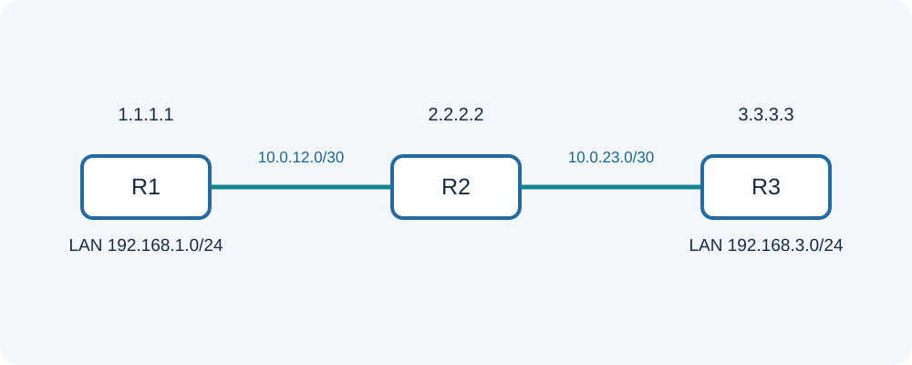
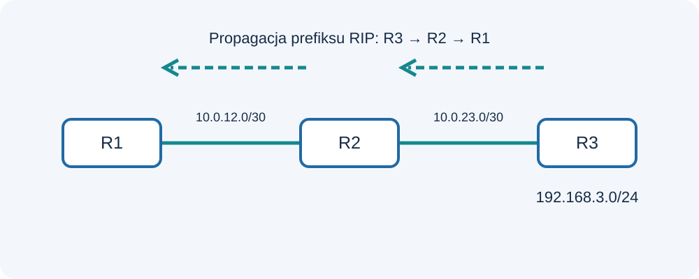
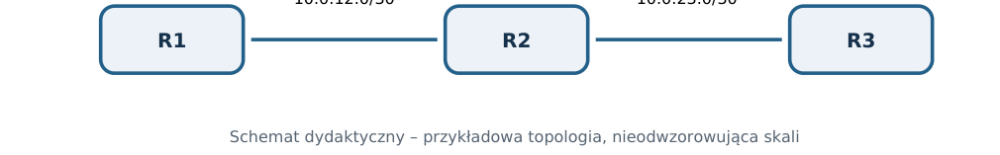

[← Sieci komputerowe](README.md) · [RIP](RIP.md) · [OSPF](OSPF.md) · [MikroTik](MikroTik_RIP_OSPF_RouterOS_v7.md)

# RIP wszystkie wersje

**PDF:** [Pobierz dokument](https://github.com/tomaszmakaedu/materialy-dydaktyczne/raw/refs/heads/main/ZSEM/Klasa%204/Sieci%20komputerowe/Skrypt_RIP_wszystkie_wersje.pdf) · **Autor:** Tomasz Mąka · **ZSEM, klasa 4t**

> Ilustracje zamieszczono poniżej; pełny układ materiału jest dostępny także w PDF.

## RIPv1 · RIPv2 · RIPng | mechanizmy, przykłady, analiza i ćwiczenia

Kompletny skrypt teoretyczny dla klasy IV technikum – technik teleinformatyk. Materiał niezależny od
producenta routera, przeznaczony do nauki, analizy topologii i powtórzeń.
Autor materiału: Tomasz Mąka | ZSEM

## Cele i sposób korzystania ze skryptu

Uczeń powinien wyjaśniać zjawiska, analizować tablice routingu i przewidywać zachowanie sieci po
zmianie topologii. Opisane wartości domyślne mogą zależeć od typu sieci, specyfikacji i implementacji.
Przykładowe topologie mają charakter dydaktyczny.

## Spis zagadnień

1. Routing IP: od pakietu do tablicy tras
2. Geneza protokołu i trzy rodziny RIP
3. Distance-vector i równanie Bellmana-Forda
4. Metryka, ograniczenie piętnastu skoków i dobór drogi
5. RIPv1: model klasowy i konsekwencje
6. RIPv2: maska, next-hop, tag i multicast
7. RIPng: routing IPv6
8. Pakiety i pola komunikatu RIP
9. Timery i cykl życia trasy
10. Konwergencja i count-to-infinity
11. Mechanizmy ograniczania pętli
12. Bezpieczeństwo RIPv1, RIPv2 i RIPng
13. Diagnostyka RIP niezależna od systemu
14. Projektowanie małej domeny RIP
15. Zestawienie wersji i synteza

## 1. Routing IP: od pakietu do tablicy tras

*Rysunek 1. Trzy routery i dwie sieci tranzytowe.*

Router przekazuje datagram IP do sieci docelowej. Najpierw sprawdza, czy odbiorca leży w sieci
bezpośrednio połączonej, a w przeciwnym przypadku wybiera next-hop na podstawie tablicy routingu.
Decyzja o trasie i faktyczne przekazanie pakietu to dwa odrębne działania: routing i forwarding.
RIB (Routing Information Base) przechowuje kandydatów na trasy, a FIB (Forwarding Information Base)
służy do efektywnego przekazywania datagramów. Przy dopasowaniu trasy podstawową zasadą jest
najdłuższy zgodny prefiks. Droga domyślna 0.0.0.0/0 zostaje użyta, gdy brak bardziej szczegółowej trasy.
Metryka wyraża koszt drogi w ramach danego protokołu, natomiast dystans administracyjny stanowi
mechanizm preferencji źródeł tras zależny od implementacji. Nie należy bezpośrednio porównywać
metryki RIP z kosztem OSPF.

### Przykład krok po kroku

Jeżeli router ma trasy 10.0.0.0/8, 10.2.0.0/16 i 10.2.3.0/24, pakiet do 10.2.3.40 zostanie dopasowany do
/24 niezależnie od samej liczby wpisów.
Jeżeli zna tylko 0.0.0.0/0, wyśle pakiet do wskazanej bramy domyślnej.

### Do zapamiętania

- Trasa connected powstaje na podstawie poprawnie zaadresowanego, aktywnego interfejsu.
- Longest prefix match jest odrębną zasadą od oceny metryk.

## 2. Geneza protokołu i trzy rodziny RIP

RIP należy do najstarszych protokołów IGP. Wywodzi się z idei routingu wektora odległości i upowszechnił
się w sieciach TCP/IP, gdy routery potrzebowały automatycznej wymiany informacji o podsieciach. RIPv1
opisuje RFC 1058, RIPv2 przede wszystkim RFC 2453, a RIPng dla IPv6 – RFC 2080.
RIPv1 przenosi adres docelowy, lecz nie przenosi jawnie maski podsieci: to protokół klasyczny. RIPv2
dołącza maskę, route tag i pole next-hop, umożliwiając routing bezklasowy. RIPng zachowuje filozofię
distance-vector, ale operuje na prefiksach IPv6 i wykorzystuje odrębny port i multicast.
Wszystkie trzy wersje są historycznie istotne; w nowoczesnych dużych sieciach często zastępuje je OSPF
lub IS-IS. Wiedza o RIP pozwala jednak zrozumieć źródła problemów konwergencji i pętli.

### Do zapamiętania

- RIP nie jest jednym identycznym formatem pakietu dla IPv4 i IPv6.
- Nie każda współczesna implementacja obsługuje RIPv1.

## 3. Distance-vector i równanie Bellmana-Forda

*Rysunek 2. Rozgłaszanie trasy od R3 przez R2 do R1.*

Każdy router przechowuje informację, jaką odległość ma do znanych sieci oraz od którego sąsiada
uzyskał najlepszą propozycję trasy. Router nie buduje pełnej mapy wszystkich łączy. Zamiast tego
wymienia wektory odległości z routerami sąsiednimi.
Zasada Bellmana-Forda w dydaktycznym uproszczeniu brzmi: koszt dojścia do celu przez sąsiada = koszt
dotarcia do sąsiada + koszt drogi reklamowanej przez sąsiada. W RIP koszt łącza na potrzeby metryki
hop count zwiększa liczbę skoków o jeden.

Proces jest rozproszony: po otrzymaniu lepszej reklamy router aktualizuje informację, a następnie
udostępnia ją innym. Ponieważ wiedza jest pośrednia, przez pewien czas sąsiad może przekazywać
nieaktualne informacje.

### Przykład krok po kroku

R3 zna sieć LAN bezpośrednio. R2 odbiera jej reklamę przez R3 i instaluje trasę o metryce 1. R1
otrzymuje tę informację od R2 i instaluje metrykę 2.
Po pojawieniu się krótszej drogi R1 może zmienić next-hop, nawet jeżeli sieć docelowa nie zmieniła
adresacji.

### Do zapamiętania

- Nie wolno utożsamiać liczby skoków z opóźnieniem ani przepustowością.

## 4. Metryka, ograniczenie piętnastu skoków i dobór drogi

Metryka RIP przyjmuje użyteczne wartości od 1 do 15. Wartość 16 jest zarezerwowana jako
nieskończoność, czyli informacja o nieosiągalności trasy. Ograniczenie przyspiesza zakończenie
niekorzystnego procesu count-to-infinity, lecz ogranicza rozmiar użytecznej domeny routingu.
Droga o mniejszej liczbie skoków jest lepsza w rozumieniu RIP, nawet gdy poszczególne łącza mają słabą
przepustowość. Protokół nie wykorzystuje standardowo opóźnień, obciążenia, jittera ani prędkości
portów do wyliczania metryki.
Przy równych metrykach wykorzystanie wielu tras zależy od implementacji. Nie należy obiecywać
automatycznie równomiernego rozdzielania pojedynczego strumienia ruchu.

### Przykład krok po kroku

Droga A: R1 → R2 → R4 – dwa skoki. Droga B: R1 → R3 → R5 → R4 – trzy skoki. RIP preferuje drogę A, choć
łącza drogi B mogą być szybsze.

### Do zapamiętania

- Metryka 16 nie oznacza szesnastu poprawnych skoków; to kod nieosiągalności.

## 5. RIPv1: model klasowy i konsekwencje

RIPv1 opisany w RFC 1058 wysyła informacje o sieciach IPv4 bez dołączania maski do każdego wpisu.
Odbiorca musi ją wnioskować z historycznych zasad klas adresowych i kontekstu interfejsu. Bywa to
niejednoznaczne w projektach wykorzystujących VLSM i nieciągłe zakresy adresowe.

RIPv1 korzysta z rozgłaszania broadcast, które może trafiać również do urządzeń nieuczestniczących w
routingu. RIPv1 nie definiuje mechanizmu uwierzytelniania zapewniającego integralność wiadomości. Dla
współczesnych wdrożeń są to poważne ograniczenia.
Warto pokazać uczniom, dlaczego zastosowanie sieci 10.1.0.0/24 i 10.2.0.0/25 rozdzielonych innym
segmentem wymaga poprawnego przenoszenia informacji o długościach prefiksów.

### Do zapamiętania

- RIPv1 jest protokołem classful; samo zastosowanie IPv4 nie oznacza obsługi CIDR.

## 6. RIPv2: maska, next-hop, tag i multicast

RIPv2 rozszerza format komunikatu o Subnet Mask, Next Hop i Route Tag. Maska umożliwia bezklasowe
rozgłaszanie prefiksów, a route tag pomaga w identyfikacji pochodzenia trasy, np. podczas redystrybucji.
Pole next-hop może wskazać bardziej odpowiedni następny router na danym segmencie.
RIPv2 wykorzystuje UDP 520 i multicast IPv4 224.0.0.9 do standardowej wymiany informacji, chociaż
specyfikacja dopuszcza określone tryby zgodności. Protokół przewiduje komunikaty Request i Response
oraz okresowe uaktualnienia.
RIPv2 nadal pozostaje protokołem distance-vector z hop count i infinity=16. Rozwój pól komunikatu nie
zmienia podstawowej metryki.

### Przykład krok po kroku

Przykładowy wpis: adres 192.0.2.0, maska 255.255.255.0, next-hop 0.0.0.0, metryka 2. Odbiorca
interpretuje /24 i wylicza własną metrykę na podstawie drogi przez reklamującego.

### Do zapamiętania

- RIPv2 przenosi maskę, ale nie eliminuje słabej skalowalności distance-vector.

## 7. RIPng: routing IPv6

RIPng opisany w RFC 2080 służy do przenoszenia informacji o prefiksach IPv6. Wykorzystuje UDP 521
oraz multicast FF02::9. Routery wysyłają komunikaty przede wszystkim na lokalnych segmentach IPv6;
adresy link-local odgrywają istotną rolę w identyfikacji sąsiadów.
RIPng przenosi prefiks IPv6, długość prefiksu, route tag i metrykę. Specjalne kodowanie pozwala wskazać
następny skok. Tak jak RIPv2 używa liczby skoków i wartości 16 jako nieskończoności.
RIPng nie kopiuje modelu pól uwierzytelniania RIPv2. Ochronę komunikacji rozpatrywano w kontekście
mechanizmów IPv6/IPsec; nie należy przedstawiać jej jako identycznej z prostym hasłem w RIPv2.

### Przykład krok po kroku

Prefiks 2001:db8:100::/64 reklamowany przez sąsiada może po przejściu przez kolejny router otrzymać
większą metrykę. Trasa powinna nadal zawierać długość /64, nie maskę dziesiętną jak w IPv4.

### Do zapamiętania

- RIPng nie jest „RIPv3”; ma własną nazwę i odrębne RFC.

## 8. Pakiety i pola komunikatu RIP

Nagłówek RIP obejmuje pole Command określające Request albo Response, pole Version i pole
zarezerwowane. Wpis trasy RIPv1 zawiera AFI, adres IPv4, pola zarezerwowane i metrykę. W RIPv2 część
pól otrzymała nowe znaczenia: route tag, maska i next-hop.
W standardowym komunikacie RIP dla IPv4 może znajdować się do 25 typowych wpisów tras bez
dodatkowego pola uwierzytelniania. Jeżeli uwierzytelnianie zajmuje miejsce wewnątrz struktury, liczba
wpisów z trasami może być mniejsza.
RIPng wykorzystuje wpisy z prefiksem IPv6 (128 bitów), route tag, długością prefiksu i metryką.
Szczególna wartość metryki służy do wyrażenia następnego skoku.

### Do zapamiętania

- W analizatorze pakietów trzeba odróżniać pola protokołu routingu od nagłówka UDP i IP.

## 9. Timery i cykl życia trasy

RIP tradycyjnie wysyła okresowe pełne aktualizacje co około 30 sekund, z niewielkim rozproszeniem
czasowym. Jeżeli informacja nie zostanie odświeżona, po około 180 sekundach trasa jest traktowana jako
nieaktualna. Następnie uruchamiany jest mechanizm garbage collection związany z usuwaniem
nieaktualnych informacji.
Triggered update oznacza wysyłkę aktualizacji po istotnej zmianie, bez oczekiwania na następny pełny
cykl. Jej praktyczne zachowanie i ograniczenia zależą od implementacji oraz od zabezpieczeń przed
nadmierną liczbą wiadomości.
Warto odróżnić czas wykrycia fizycznej awarii łącza od czasu uznania trasy za nieważną wskutek braku
aktualizacji. Są to odmienne ścieżki diagnostyczne.

### Przykład krok po kroku

T=0: awaria LAN za R3. T≈0: R3 może rozgłosić poisoning. Bez takiej informacji R2 może przez pewien
czas zachować stary wpis. T=180 s bez odświeżenia: standardowy timeout informacji o trasie.

### Do zapamiętania

- Hold-down nie jest uniwersalnym timerem wymaganym przez każdą wersję RFC; często opisuje
rozwiązania implementacyjne.

## 10. Konwergencja i count-to-infinity

Konwergencja to stan, w którym uczestnicy protokołu uzgodnili aktualny obraz osiągalności i ich decyzje
o trasach są stabilne. Po awarii może pojawić się okres przejściowy, w którym poszczególne routery
dysponują różnymi wersjami informacji.
Count-to-infinity powstaje, gdy routery nawzajem utwierdzają się w przekonaniu, że drugi z nich ma
drogę do niedostępnego celu. Wtedy metryki rosną stopniowo. Ograniczenie infinity do 16 zapewnia kres
procesu, ale nie usuwa natychmiast okresu niestabilności.
Pętla routingu powoduje krążenie pakietów, zanim TTL (IPv4) lub Hop Limit (IPv6) wyczerpie się. W czasie
pętli usługi mogą być niedostępne pomimo obecności pozornie poprawnego wpisu w tablicy.

### Przykład krok po kroku

R1 nauczył się sieci X od R2, a R2 od R3. Po awarii X router R2 może błędnie uznać R1 za alternatywnego
dostawcę trasy. Bez mechanizmów ochronnych zachodzi wzrost metryk aż do 16.

## 11. Mechanizmy ograniczania pętli

Split Horizon zabrania rozgłaszania trasy przez interfejs, z którego została nauczona. Poison Reverse
rozgłasza taką trasę z metryką 16, wprost informując sąsiada, że nie należy kierować pakietów przez
nadawcę. Route Poisoning dotyczy oznaczenia niedostępnego celu metryką 16.
Triggered Updates przyspieszają propagację zmian. Garbage collection usuwa przeterminowane wpisy.
W różnych implementacjach spotyka się także hold-down, ale nie należy utożsamiać tej opcji z
obowiązkowym zachowaniem całego standardu RIP.
Żaden pojedynczy mechanizm nie daje idealnej ochrony w dowolnej topologii. Właściwy projekt
uwzględnia prostotę domeny, ograniczenie uczestników i kontrolę redystrybucji.

### Do zapamiętania

- Split Horizon i Poison Reverse to mechanizmy zapobiegania dezinformacji zwrotnej.

## 12. Bezpieczeństwo RIPv1, RIPv2 i RIPng

RIPv1 nie oferuje własnego uwierzytelniania. RIPv2 wprowadził mechanizmy autentykacji, lecz proste
hasło transmitowane jawnie nie zapewnia poufności. Rozwiązania kryptograficzne opisano między innymi
w RFC 2082 oraz RFC 4822. Nie wszystkie starsze mechanizmy spełniają współczesne wymagania
bezpieczeństwa.
Ryzykiem jest przejęcie lub podszywanie się pod routera, rozgłoszenie drogi do niepożądanego next-hop
albo celowe oznaczenie trasy jako niedostępnej. Szyfrowanie ruchu użytkownika nie wynika z samego
działania RIP.
RIPng funkcjonuje w środowisku IPv6 i nie ma takich samych pól autentykacji jak RIPv2. Bezpieczeństwo
trzeba rozpatrywać wraz z mechanizmami ochrony IPv6, izolacją płaszczyzny sterowania i filtrowaniem
dostępu.

### Do zapamiętania

- Uwierzytelnianie to nie szyfrowanie.
- Doświadczenia laboratoryjne powinny działać wyłącznie w izolowanej sieci.

## 13. Diagnostyka RIP niezależna od systemu

Diagnostykę zaczyna się od fizycznej i logicznej łączności, prawidłowej adresacji i możliwości przesłania
pakietu do sąsiada. Następnie sprawdza się konfigurację protokołu, port UDP, tryb multicast/broadcast
oraz zgodność wersji.
Kolejny etap to analiza otrzymywanych prefiksów i ich metryk. Jeśli router odbiera aktualizacje, ale nie
instaluje trasy, należy rozważyć inny lepszy wpis, filtr, błędną maskę, wartość 16 lub problemy
redystrybucji.
Do obserwacji można użyć przechwytywania ruchu i odczytać nagłówki RIP. Trzeba także sprawdzić
drogę zwrotną, ponieważ sama obecność trasy na jednym routerze nie gwarantuje dwukierunkowej
komunikacji.

### Przykład krok po kroku

Objaw: sąsiednie routery odpowiadają na ping, lecz R1 nie widzi LAN za R3. Kontrola: aktualizacje UDP
520/521, czy prefiks LAN jest ogłaszany, metryka, filtracja, maska i trasa powrotna.

## 14. Projektowanie małej domeny RIP

RIP może być użyteczny w prostych, niewielkich sieciach, w których ograniczona liczba skoków nie jest
problemem. Należy zaplanować adresację, dostęp uczestników protokołu i sposób rozgłaszania tras LAN.
Interfejs pasywny pozwala ogłosić prefiks sieci bez wysyłania pakietów protokołu do urządzeń
końcowych, jeżeli dana implementacja obsługuje taki model. Redystrybucja tras powinna być filtrowana;
wymiana tras w obie strony między protokołami może prowadzić do pętli.
Projektant powinien również określić, jak sieć zachowa się przy awarii, czy istnieją alternatywne drogi
oraz kiedy należy przejść na skalowalny protokół link-state.

### Do zapamiętania

- Prosty protokół nie zwalnia z obowiązku zaprojektowania domeny routingu.

## 15. Zestawienie wersji i synteza

RIPv1, RIPv2 i RIPng mają wspólną logikę distance-vector oraz tę samą ideę metryki hop count. Różnią
się rodziną adresów, formatami rekordów, możliwościami przenoszenia masek i prefiksów oraz sposobem
transportu.
Wspólnym ograniczeniem jest metryka 16 jako nieskończoność. Zasadniczą przewagą RIPv2 nad RIPv1
jest obsługa bezklasowych prefiksów IPv4; RIPng nie jest rozszerzeniem formatu RIPv2 o większy adres,
tylko osobną specyfikacją dla IPv6.
Najważniejszym celem nauki RIP jest umiejętność odtworzenia, jak informacja o sieci przemieszcza się
przez kolejne routery i dlaczego czasami staje się nieaktualna.

## Porównanie wszystkich wersji RIP

| Cecha | RIPv1 | RIPv2 | RIPng |
| --- | --- | --- | --- |
| RFC | 1058 | 2453 | 2080 |
| Rodzina | IPv4 | IPv4 | IPv6 |
| Maska/prefiks | Brak maski | Maska jawna | Długość prefiksu |
| Transport | UDP 520 | UDP 520 | UDP 521 |
| Rozgłaszanie | Broadcast | 224.0.0.9 | FF02::9 |
| Metryka | 1–15, 16=∞ | 1–15, 16=∞ | 1–15, 16=∞ |

## Zadania sprawdzające

**Zadanie 1.** R1 ma drogę do LAN przez R2 o metryce 4. R2 reklamuje alternatywną trasę o metryce 2.
Jakiej metryki może oczekiwać R1 po przejściu przez R2?

**Odpowiedź:** 3, jeżeli warunki propagacji i wybór trasy są zgodne ze standardowym modelem hop count.

**Zadanie 2.** Dlaczego RIPv1 nie nadaje się do elastycznego planu VLSM?

**Odpowiedź:** Nie przenosi jawnej maski w każdym wpisie, więc odbiorca nie może dowolnie odtworzyć długości
prefiksu.

**Zadanie 3.** Jak interpretować metrykę 16?

**Odpowiedź:** Jako trasę nieosiągalną, a nie poprawną drogę przez 16 routerów.

**Zadanie 4.** Czym różni się Split Horizon od Poison Reverse?

**Odpowiedź:** Pierwszy pomija reklamę w kierunku źródła; drugi jawnie reklamuje ją z metryką 16.

**Zadanie 5.** Która wersja RIP przenosi prefiksy IPv6?

**Odpowiedź:** RIPng (RFC 2080), UDP 521, multicast FF02::9.

**Zadanie 6.** Czy RIP wybierze szybsze łącze o większej liczbie skoków?

**Odpowiedź:** Nie na podstawie samej szybkości: podstawowa metryka to hop count.

**Zadanie 7.** Co może spowodować pętlę po awarii celu?

**Odpowiedź:** Nieaktualne wzajemnie rozpowszechniane trasy i zjawisko count-to-infinity.

**Zadanie 8.** Co należy sprawdzić przed analizą pakietów RIP?

**Odpowiedź:** Stan łączy, adresację, osiągalność sąsiada oraz reguły filtrujące ruch protokołu.

## Podstawy normatywne i źródła

- [RFC 1058 — Routing Information Protocol](https://www.rfc-editor.org/rfc/rfc1058)
- [RFC 2453 — RIP Version 2](https://www.rfc-editor.org/rfc/rfc2453)
- [RFC 2080 — RIPng for IPv6](https://www.rfc-editor.org/rfc/rfc2080)
- [RFC 4822 — RIPv2 Cryptographic Authentication](https://www.rfc-editor.org/rfc/rfc4822)

